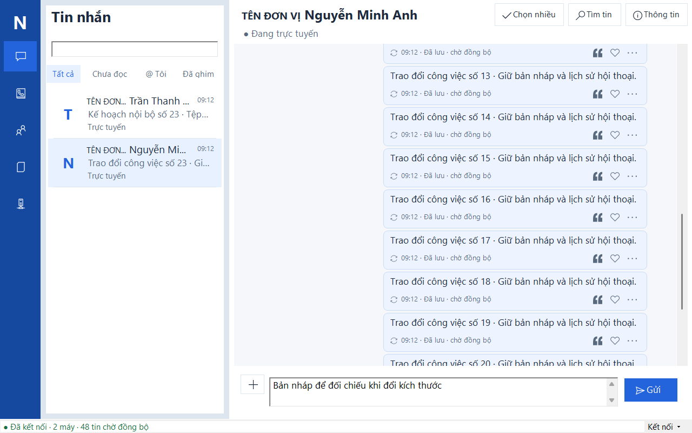
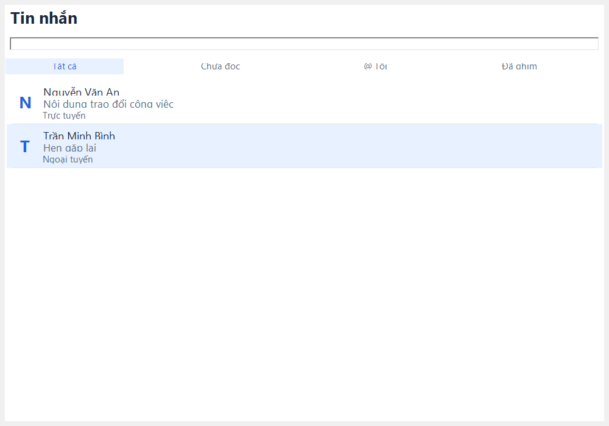

# LanChat v1.2.13 — Chat nội bộ cho Windows

v1.2.13 giảm tải khi quét LAN, đồng bộ và tải tệp nền ở chế độ tiết kiệm tài nguyên, chia lịch sử nhóm thành các lô nhỏ hơn khi đồng bộ lại, cập nhật biểu tượng và GIF gợi ý, đồng thời bổ sung thông báo giấy phép thư viện trong mục **Giới thiệu**.

v1.2.12 bổ sung emoji màu từ Windows, gợi ý emoji và GIF cho cụm từ tiếng Việt, chế độ tiết kiệm tài nguyên hệ thống và hướng dẫn ngay trong các ô nhập. Nút **Tải và Cài đặt** xuất hiện ở cuối thanh trên cùng khi có bản cập nhật.

v1.2.10 nâng cấp bố cục cửa sổ rộng/trung bình/hẹp, thêm bộ lọc hội thoại, khung soạn gọn với nút **+**, trung tâm tệp, tìm kiếm rõ phạm vi và tùy chỉnh cỡ chữ/mật độ. **Thêm** chứa Giới thiệu, cập nhật và hướng dẫn; badge phiên bản mới cũng nằm trên nút này. Ứng dụng tiếp tục tải cập nhật nền và chỉ cài khi bạn chọn **Cài đặt ngay**.

Giữ WinForms/.NET Framework 4.8, giao thức và dữ liệu hiện có. [Chi tiết nâng cấp UI/UX và giới hạn kiểm chứng](docs/UI_UX_IMPLEMENTATION.md).

LanChat hỗ trợ chat riêng, chat nhóm và truyền ảnh, tệp, thư mục giữa các máy Windows trên mạng LAN. Mỗi máy lưu dữ liệu trong SQLite. Tin nhắn và tệp được mã hóa đầu cuối. Cập nhật hỗ trợ GitHub, máy cùng mạng chat trong LAN hoặc bộ cài cục bộ; LAN và bộ cài cục bộ hoạt động không cần Internet.

## Giao diện LanChat





[Xem thêm ảnh trước và sau](docs/UI_UX_IMPLEMENTATION.md#4-ảnh-và-ma-trận-kiểm-tra).

## Tải và bắt đầu sử dụng

1. Tải **LanChat-Setup-Windows-x64.exe** từ [GitHub Releases](https://github.com/dattiphu2022/LanChat/releases/latest) và chạy bộ cài. Hỗ trợ Windows 10 từ phiên bản 1903 và Windows 11 x64 với .NET Framework 4.8.
2. Mở **Cài đặt** để nhập **Tên** và **Đơn vị**. Danh bạ hiển thị đơn vị trước tên.
3. Mở **Mạng chat → Thêm mã** nếu đã có mã. Chọn **Tạo mạng** nếu bạn muốn bắt đầu mạng mới. Để mời máy khác, mở **Chi tiết → Hiện mã mời tham gia** và gửi mã cho người được phép tham gia.
4. Chọn người dùng trong **Danh bạ** hoặc bấm **Quét tất cả** để tìm lại máy. Dùng các tab để đổi mạng.

Mở **Giới thiệu → Hướng dẫn sử dụng** để đọc hướng dẫn ngay trong ứng dụng, kể cả khi đang ngoại tuyến. Tài liệu này cũng có trên GitHub. [Hướng dẫn sử dụng](docs/HUONG_DAN_SU_DUNG.md)

## Nhắn tin, gửi ảnh và tệp

- Trong ô soạn, **Enter** gửi tin và **Shift+Enter** xuống dòng. **Ctrl+F** hoặc **Ctrl+K** mở ô tìm tên người trong **Tin nhắn**. Nhấn **Enter** trong ô tìm để mở kết quả đầu tiên. Bấm **Tìm tin** trong hội thoại để tìm theo nội dung. Bấm khung trích dẫn để đến tin gốc, rồi chọn **Quay về tin nhắn mới** để trở lại cuối hội thoại.
- Ô soạn tự giãn theo các dòng hiển thị, tối đa 8 dòng và khoảng 45% vùng chat; nội dung dài hơn cuộn trong ô nhập. Bản nháp và vị trí đang đọc lịch sử được giữ khi ô soạn đổi chiều cao.
- Dùng **Dán ảnh**, **Chụp vùng** hoặc kéo tệp vào ô soạn tin. LanChat tạm ẩn khi chụp vùng và hiện lại khi chụp xong hoặc nhấn **Esc**.
- Nội dung nhập cùng ảnh là chú thích chung cho lần gửi. Bấm ảnh để mở khung xem lớn. Dùng **Trước/Sau** hoặc phím mũi tên để chuyển ảnh, cuộn chuột để phóng to và **Esc** để đóng.
- Dùng **Đính kèm → Thêm thư mục** để chọn thư mục từ Windows. Mỗi thư mục có thể chứa tối đa 10.000 mục và 20 GB dữ liệu. Khi gửi hoặc nhận tin, ảnh, tệp và toàn bộ nội dung thư mục tự tải về nền và được kiểm tra SHA-256. Bấm tên tệp hoặc thư mục để mở bản đã chuẩn bị trên máy.
- Bấm **Lưu về máy** cạnh đính kèm để chọn nơi lưu bản đang làm việc, gồm các chỉnh sửa cục bộ. **Mở** dùng đúng vị trí đã lưu, kể cả sau khi khởi động lại. Menu tin nhắn có **Lưu tất cả đính kèm của tin…**; menu khung xem ảnh có **Lưu tất cả ảnh của tin…**.

Tin đã đồng bộ nghĩa là ít nhất một máy khác có bản sao. Trạng thái **Đã nhận** và **Đã đọc** dựa trên xác nhận của người tham gia. Ghim, tắt thông báo và xóa phía tôi áp dụng trên máy này.

Các máy chạy v1.2.5 tự bổ sung lịch sử nhóm từ máy thành viên còn giữ và đọc được tin, kể cả khi máy gửi gốc đã ngoại tuyến. Thành viên hiện tại của nhóm có thể nhận tin cũ, nội dung đã sửa, trạng thái thu hồi và tệp đính kèm. Cập nhật các máy trong nhóm lên v1.2.5 để dùng tính năng này.

Mạng có ba voter đang hoạt động ổn định chịu được một máy mất kết nối mà vẫn thay đổi cấu trúc nhóm. Khi thiếu số máy điều phối cần thiết, tin nhắn vẫn được lưu và có thể đồng bộ giữa các máy còn kết nối.

Khi chỉ còn hai máy kết nối trong mạng thiếu phiếu, LanChat chọn một máy điều phối. Hai máy chạy v1.2.3 trở lên có thể tạo nhóm mới cho hai người và dùng ngay. Sửa nhóm đã có vẫn cần đủ phiếu. Các máy v1.2.2 tiếp tục nhắn tin, gửi tệp và nhận nhóm mới khi nhóm được xác nhận trong nhật ký chung.

Trong **Cài đặt**, bật **Khởi động cùng hệ thống** để mở LanChat khi đăng nhập Windows. Nhấn **Thu nhỏ** hoặc **X** để đưa LanChat xuống khay hệ thống. Nhấp đúp biểu tượng để mở lại, hoặc bấm chuột phải và chọn **Thoát LanChat** để dừng ứng dụng.

## Nhắc tên và chuyển tiếp nhiều người

Trong nhóm, gõ **@** rồi chọn người hoặc **@All** từ gợi ý; dùng mũi tên và Enter để chọn, Esc để đóng. Có thể tìm tên không dấu. Chỉ tên đã chọn mới tạo lời nhắc; email hoặc chữ @ tự dán vẫn là văn bản thường. Người được nhắc thấy tên mình tô xanh và thông báo **đã nhắc tới bạn**, kể cả khi nhóm im lặng. Mọi thành viên được dùng @All. Sửa tin cập nhật lời nhắc nhưng không phát lại toast.

Menu **Chuyển tiếp** cho phép tích nhiều người trong toàn bộ danh bạ của mạng hiện tại, gồm người chưa từng nhắn hoặc đang offline, và các nhóm đang tham gia. Trong **Chọn nhiều**, bấm **Chuyển tiếp** để gửi nhiều tin theo thứ tự lịch sử. Danh sách giữ dấu tích khi tìm kiếm. Kết quả cho biết từng mục đã lưu chờ gửi, lỗi hoặc hủy; **Thử lại mục chưa gửi** giữ phần thành công. Chuyển tiếp giữ chữ @ nhưng không nhắc lại người nhận. Giới hạn QR không áp dụng cho chuyển tiếp.

Khi mở/lưu đính kèm, tiến độ phân biệt chờ tác vụ, chờ nguồn, tải, kiểm tra và chuẩn bị. Đóng/hủy một cửa sổ không hủy lượt chuẩn bị còn người khác đang dùng. Nguồn không trả lời sẽ hết hạn và có thể thử lại; không cần chờ 30 phút.

## Chọn nhiều tin và chia sẻ QR

Bấm **Chọn nhiều** trên tiêu đề chat để hiện checkbox. Chọn từng tin, **Chọn tất cả** trong phần lịch sử đang hiển thị, **Bỏ chọn** hoặc **Hủy chọn**. Tải tin cũ hơn để chọn thêm. Các lựa chọn được giữ khi làm mới; đổi hội thoại sẽ hủy chế độ. Tin đã thu hồi không được xuất.

**Xuất QR** mở bản xem trước QR và văn bản nguyên gốc. Các tin ghép theo thời gian tăng dần bằng hai ký tự xuống dòng LF, không thêm tên người gửi hay thời gian, không chuẩn hóa hoặc cắt nội dung. QR là Plain Text UTF-8, ECC M, tối đa Version 18 và **500 byte UTF-8** tính cả dấu phân cách. Khi vượt giới hạn, nút xuất bị khóa và hiện dung lượng để bỏ chọn bớt. PNG có nền trắng, vùng trống và điểm ảnh sắc nét; toàn bộ thao tác chạy trên máy, không gọi dịch vụ tạo QR.

## Mã mặc định cho nhiều máy

Bản phát hành nội bộ tự tham gia mạng mặc định được nhúng trong EXE. Khi cài bản có mã mới, LanChat tự chuyển mạng mặc định đang bật và tiếp tục lưu lịch sử theo từng mã. Nếu đã gỡ mạng mặc định, dùng **Khôi phục mạng mặc định** trên thanh công cụ của cửa sổ chính để bật lại. Xem [hướng dẫn bộ cài](installer/README.md) để cấp hoặc đổi mã cho bản build.

## Nâng cấp

Mở **Cài đặt → Cài đặt cập nhật** hoặc **Giới thiệu → Cài đặt cập nhật** để chọn nguồn dùng chung cho ứng dụng:

- **Online — GitHub**: mặc định; tự kiểm tra tối đa một lần mỗi 24 giờ, hoặc bấm kiểm tra thủ công.
- **Máy trong LAN**: chọn mạng đang kết nối và máy theo **Tên · Đơn vị · Tên máy**. Phần nâng cao cho nhập IPv4 và cổng TCP thực tế. LanChat xác minh định danh và khóa thiết bị trước khi lưu; tên hiển thị không phải khóa nhận diện. LAN kiểm tra khi khởi động, khi áp dụng cấu hình và khi bấm kiểm tra. Nếu nguồn lỗi, giữ lựa chọn và cho thử lại, không chuyển sang GitHub.
- **Bộ cài trên máy này**: chọn EXE bộ cài LanChat để kiểm tra sản phẩm, phiên bản và sao chép vào cache riêng. Không sửa hoặc di chuyển tệp đã chọn. Chỉ cài gói mới hơn phiên bản đang dùng.

Để phân phối offline, bật **Máy này cung cấp cập nhật qua LAN**, chọn bộ cài và xác nhận các mạng được phép nhận. Chia sẻ mặc định tắt, độc lập với nguồn cập nhật của máy chủ; máy chủ có thể tiếp tục dùng GitHub hoặc tự cài chính gói cục bộ. Cần giữ ứng dụng và mạng được chọn đang chạy. Có tối đa bốn lượt tải cùng lúc; đổi hoặc ngừng chia sẻ gói không cắt lượt tải đã bắt đầu. Trước khi tự cài hoặc thoát, chờ các lượt đang phục vụ hoàn tất.

Máy nhận và máy nguồn phải cùng mạng chat và đều hỗ trợ cập nhật LAN. Với máy v1.2.6 trở về trước, cài phiên bản hỗ trợ tính năng này bằng EXE hoặc GitHub trước. Manifest LAN được ký bằng khóa thiết bị đã ghim, xác nhận đúng máy bạn chọn; SHA-256 kiểm tra tính nguyên vẹn, không chứng nhận gói đến từ GitHub. Bộ cài đã tải và xác minh vẫn cài được khi nguồn ngoại tuyến.

Khi có phiên bản mới, dùng nút **Tải và Cài đặt** ở cuối thanh trên cùng. Trong lúc tải, tiêu đề cửa sổ hiển thị tiến độ và thanh trên cùng có nút **Hủy tải**. Bạn cũng có thể mở **Thêm → Giới thiệu và cập nhật…** để kiểm tra thủ công. LanChat xác minh lại bộ cài và nhắc xử lý bản nháp trước khi thoát để cài. Có thể cài thủ công EXE từ GitHub Releases bằng cùng tài khoản Windows sau khi dùng **Thoát LanChat** ở khay hệ thống.

Khi nâng từ giao thức cũ lên **giao thức v4** lần đầu, migration xóa lịch sử tin nhắn cũ, chỉ mục tìm kiếm và các tin đang chờ gửi. Sao lưu khi LanChat đã thoát nếu cần lưu dữ liệu cũ để tra cứu. Bảo vệ bản sao vì có thể chứa dữ liệu dạng rõ.

Ứng dụng giữ mã mời v2, danh tính cục bộ, danh bạ và cấu hình từng mạng. Nhóm đang hoạt động được tạo lại từ danh sách thành viên trên máy chủ nhóm khi máy đó có kết nối đến máy điều phối. Những người nhận cần chạy bản mới ít nhất một lần để LanChat ghi nhận khóa trước khi gửi tin cho họ.

Nếu cửa sổ **Nâng cấp mạng chat** xuất hiện với cấu hình Phase 1, chọn một máy tạo mã nâng cấp và nhập cùng mã đó trên các máy còn lại. Dùng thư mục dữ liệu riêng của từng máy. Máy tạo mã cần trực tuyến để thiết lập điều phối ban đầu.

## Build, test và publish

PowerShell tại thư mục solution:

```powershell
# Chạy tại thư mục chứa LanChat.sln
dotnet restore LanChat.sln
dotnet build LanChat.sln --no-restore
dotnet test tests/LanChat.Tests --no-restore
dotnet run --project src/LanChat.WinForms --no-build
```

Project khởi động trong Visual Studio là **LanChat.WinForms**. Máy build cần .NET SDK hỗ trợ C# 13 và reference assemblies .NET Framework 4.8.

Để làm bộ cài công khai, chọn **LanChat.WinForms → Publish → PublicRelease**, rồi mở `installer/LanChat.Public.iss` và chọn **Build → Compile** trong Inno Setup. Tệp `LanChat-Setup-Windows-x64.exe` nằm trong `artifacts/public-release/installer`. [Hướng dẫn đóng gói và phát hành](installer/README.md)

```powershell
pwsh -NoProfile -File scripts/Publish-Windows.ps1 -PublicRelease
```

Bản phát hành mở một cửa sổ. Dùng các tab để kết nối nhiều mạng từ cùng tiến trình.

Kiểm tra tự động **hai tiến trình WinForms thật**, tạo dữ liệu riêng, chụp giao diện và tự đóng:

```powershell
dotnet build LanChat.sln
pwsh -NoProfile -File scripts/Verify-TwoInstances.ps1 -UseBroadcast
# Hoặc dùng UDP loopback để kiểm tra độc lập với chính sách broadcast:
pwsh -NoProfile -File scripts/Verify-TwoInstances.ps1
```

Thêm tham số **-WithLanUpdate** để kiểm tra truyền bộ cài giả lập qua LAN giữa hai tiến trình; kiểm thử không chạy bộ cài.

Script cần PowerShell 7. Mỗi lần tạo thư mục `.codex-temp/two-instances-<thời điểm>`, không ghi vào dữ liệu thật. Dữ liệu mẫu gồm hai hồ sơ, chat, nhóm, ảnh và tệp. Muốn bắt đầu lại chỉ cần chạy lại script; không cần xóa/reset database đang dùng. Hook kiểm tra và các nút mô phỏng lỗi chỉ có trong Debug.

## Mạng

Mặc định **UDP 54545** discovery; **TCP/TLS 54546** cho sự kiện, điều phối và truyền tệp. Không cần IP server cố định. UDP công bố cổng TCP của peer; quét TCP fallback dò cổng service đang cấu hình.

LanChat phát discovery UDP có xác thực khi khởi động, đổi IP hoặc bấm **Quét lại**. TCP dự phòng bắt đầu sau 750 ms, ưu tiên địa chỉ đã biết và dò cổng LanChat trong subnet IPv4 cục bộ. Quét có thể hủy, chạy tối đa 64 kết nối đồng thời cho mỗi mạng. Các mạng dùng chung cổng UDP khám phá, có cổng TCP riêng được công bố qua UDP. Dò TCP dự phòng thử cổng mặc định, cổng tính từ mã mạng và các địa chỉ đã biết.

LanChat xác nhận trạng thái trực tuyến qua TCP/TLS và lưu các địa chỉ đã thấy của mỗi máy. Khi đường gửi tin đang dùng gặp lỗi, ứng dụng thử địa chỉ khác. Một chiều kết nối TCP còn hoạt động có thể đồng bộ tin nhắn theo cả hai chiều.

**Mạng chat → Chi tiết** cho phép ứng cử, đề cử và lưu lựa chọn **Cho phép máy này làm trung tâm**. Sau 5 giây vắng heartbeat, các máy đủ điều kiện bắt đầu kiểm tra phiếu. Khi trung tâm có đa số và đã commit trong nhiệm kỳ mới, ứng dụng đánh thức đồng bộ. Khi thiếu đa số hoặc mọi máy rút lui, các máy còn kết nối vẫn có thể trao đổi tin nhắn.

Nếu Windows Firewall hỏi, cho phép trên mạng nội bộ tin cậy. Từ thư mục mã nguồn, quản trị viên có thể chạy script sau trên từng máy. Quy tắc áp dụng cho EXE đã cài và các cổng TCP của LanChat, giới hạn ở subnet nội bộ trên profile Domain hoặc Private.

```powershell
.\scripts\Enable-LanChatFirewall.ps1 -AppPath 'C:\duong-dan\LanChat.WinForms.exe'
```

Khi bật nhiều mạng, xem cổng TCP thực tế trong **Mạng chat → Chi tiết → Kết nối** và thêm các cổng đó vào rule nếu môi trường yêu cầu lọc theo cổng. VLAN, Wi-Fi client isolation và policy broadcast cần kiểm tra tại nơi triển khai.

## Dữ liệu và giới hạn cần biết

- Dữ liệu mặc định: `%LOCALAPPDATA%\LanChat\Data`. SQLite WAL, event/projection/outbox cùng transaction; không dùng SQLite qua network share hoặc thư mục liên kết.
- Nội dung tin riêng, tin nhóm, sửa tin, cảm xúc, xác nhận đọc và khóa tệp được mã hóa đầu cuối. Máy ngoài cuộc có thể chuyển tiếp bản mã. Tệp, ảnh và thư mục được mã hóa trước khi truyền, rồi giải mã trên thiết bị người nhận.
- Mỗi thiết bị giữ khóa riêng được bảo vệ bằng DPAPI CurrentUser. LanChat ghim khóa công khai lần đầu gặp và từ chối khóa thay thế cho cùng định danh. Đối chiếu dấu vân tay với người liên hệ qua kênh tin cậy ở **Mạng chat → Chi tiết → Khóa mã hóa** để xác minh lần kết nối đầu.
- TLS và HMAC bảo vệ giao thức mạng chat. Máy trong mạng vẫn thấy thông tin danh bạ, hiện diện, tên nhóm, thành viên, thời gian và định danh dùng để đồng bộ. Tin đã giải mã, chỉ mục tìm kiếm và tệp đã mở lưu ở dạng rõ tại thiết bị được cấp quyền. Việc lộ khóa riêng có thể ảnh hưởng đến bản mã đã lưu trước đó.
- Các máy nên đồng bộ giờ: envelope có cửa sổ thời gian 120 giây. HLC và sequence giải quyết thứ tự/đồng bộ; không thay thế kiểm tra giờ của xác thực.
- Không tự loại voter offline vì việc đó làm sai quorum. Nếu mất vĩnh viễn đa số voter, cần phục hồi máy/dữ liệu đã có; chưa có công cụ quản trị loại voter hoặc khôi phục cưỡng bức.
- Ảnh, tệp và thư mục trong các tin được phép xem tự tải về với tối đa hai tác vụ nền đồng thời. Ứng dụng thử lại khi nguồn chưa trực tuyến và kiểm tra lại tệp còn thiếu khi khởi động. Tối đa 20 ảnh/tệp mỗi tin và 20 GB/tệp. Tệp tạm được kiểm tra SHA-256 trước khi công bố bản hoàn chỉnh.
- Ảnh JPEG/PNG/GIF/BMP/TIFF trong vùng chat hiển thị có hình thu nhỏ với tối đa 20 MB/ảnh và hai tác vụ giải mã ảnh đồng thời. Ảnh lớn hơn vẫn tự tải về nền và có thể bấm để xem. Khung xem lớn hỗ trợ tối đa 100 MB và 40 megapixel. Ảnh vượt giới hạn có thể mở bằng **Mở**. GIF/TIFF chỉ hiển thị khung/trang đầu. Ảnh đã tải có thể xem lại khi máy gửi offline. Khung xem dùng ảnh gốc đã gửi, sửa chú thích bằng thao tác sửa tin nhắn.
- Bản làm việc ban đầu giữ tên/đuôi gốc trong `Data/Attachments/Open/<AttachmentId>/`. **Lưu về máy** lần đầu chuyển bản này tới nơi đã chọn; các lần sau sao chép sang vị trí mới và giữ bản đã lưu trước. Ánh xạ nằm riêng trong `Data/Attachments/Locations/` của từng mạng. Khi bản đã lưu bị mất, chọn tìm lại hoặc tạo lại từ bản gốc; tạo lại không phục hồi chỉnh sửa cục bộ đã mất. Chỉnh sửa bằng Word/Excel không tự gửi lại hoặc thay đổi blob gốc mà các peer tải xuống. Muốn chia sẻ nội dung đã sửa, gửi lại tệp đó. Khi sao lưu, sao lưu thêm các bản làm việc đã lưu ngoài thư mục dữ liệu.
- Sửa/xóa file gốc sau khi gửi không thay đổi nội dung đã gửi. Nếu bản lưu trong ứng dụng bị hỏng/mất, LanChat thử phục hồi từ file nguồn hoặc bản mở local còn đúng SHA256, rồi tìm bản đúng trên máy khác. File nguồn chỉ được ghi nhớ bằng đường dẫn trong dữ liệu local, không gửi đường dẫn này qua mạng. Nếu không còn bản nguyên vẹn, cần bật máy từng gửi/tải hoặc gửi lại file thành tin nhắn mới; không thay SHA của tin nhắn cũ để chấp nhận nội dung đã sửa.
- Chưa có compaction/snapshot control log, retention hoặc benchmark cụm lớn. Bản hiện tại phù hợp đánh giá trong mạng nội bộ tin cậy trước khi nghiệm thu thực tế.
- Log cuốn trong `Data/Logs`, tối đa 14 tệp, 5 MB/tệp; không ghi secret hoặc nội dung chat.
- Sao lưu cả thư mục khi app đã đóng. DPAPI gắn với tài khoản Windows; không coi bản sao cluster.json là mã mời cho máy khác.

## Ký số phát triển

Bản v1.2.7 có EXE ứng dụng và bộ cài Inno Setup ký Authenticode bằng chứng thư tự ký **CN=LanChat Development**. Đây là chữ ký phát triển, không phải chứng thư phát hành đã được CA xác thực; Windows/SmartScreen có thể vẫn cảnh báo. Không tự thêm chứng thư vào Trusted Root hoặc thay đổi Kaspersky/chính sách Windows. Xem [cấu hình, sao lưu và khôi phục chứng thư](docs/CODE_SIGNING.md).

## Tài liệu

LanChat được phát hành theo [giấy phép MIT](LICENSE). Giấy phép và thông báo bản quyền
của các thành phần đi kèm có trong [THIRD-PARTY-NOTICES.txt](docs/THIRD-PARTY-NOTICES.txt)
và trong thư mục cài đặt. Có thể xem hai tài liệu trong **Giới thiệu**.

- [Hướng dẫn sử dụng](docs/HUONG_DAN_SU_DUNG.md)
- [Kiểm chứng v1.2.8: đính kèm, nhắc tên và chuyển tiếp](docs/VERIFICATION_MENTIONS_FORWARDING.md)
- [Kiểm chứng v1.2.7: QR và ký số](docs/VERIFICATION_QR_SIGNING.md)
- [Kiểm chứng ô soạn, tên tệp và cập nhật LAN](docs/VERIFICATION_LAN_UPDATE.md)
- [Kiểm chứng lưu đính kèm](docs/VERIFICATION_ATTACHMENT_SAVE.md)
- [Đóng gói và phát hành](installer/README.md)
- [Kiến trúc và luồng dữ liệu](docs/ARCHITECTURE.md)
- [Kết quả kiểm chứng](docs/VERIFICATION.md)
- [Checklist nghiệm thu trên các PC](docs/ACCEPTANCE.md)
- [Phạm vi triển khai Phase 2–5](docs/PHASES_IMPLEMENTATION.md)
