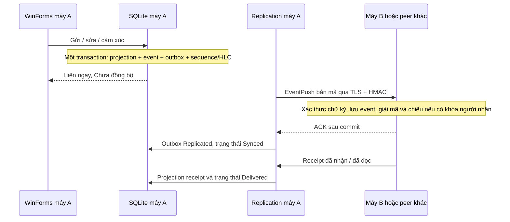

# Kiến trúc và luồng dữ liệu LanChat

## Các tầng

| Project | Vai trò chính |
|---|---|
| LanChat.Domain | Entity Guid, enum, định danh hội thoại trực tiếp, Hybrid Logical Clock |
| LanChat.Application | DTO, hợp đồng chat/replication/consensus/tệp |
| LanChat.Infrastructure | Microsoft.Data.Sqlite/SQLite, event store, projection, outbox, TLS/TCP/UDP, Raft, tệp, log |
| LanChat.WinForms | Form/UserControl native, trạng thái giao diện, Generic Host và DI |
| LanChat.Tests | Kiểm thử database, mạng thật, partition, event, tệp và bảo mật |

Form gọi các interface của tầng application. MainForm có phần thao tác nâng cao và harness Debug. **Giới thiệu → Hướng dẫn sử dụng** đọc tài liệu Markdown nhúng trong EXE nên hoạt động ngoại tuyến. [Hướng dẫn sử dụng](HUONG_DAN_SU_DUNG.md)

## Hai loại dữ liệu

**Dữ liệu chat** gồm hồ sơ, tin nhắn, sửa/thu hồi, cảm xúc, receipt và metadata tệp. Mỗi node tự ghi được khi offline. Dữ liệu đi qua immutable ReplicationEvent, đồng bộ tăng dần và hội tụ thành projection.

**Dữ liệu điều phối** gồm voter membership và cấu trúc nhóm. Chúng cần thứ tự chung và quorum; đi qua ControlLog của ConsensusService. System message về thay đổi nhóm được tạo từ control command đã commit, với Guid xác định từ command. Chúng không bị phát lại thành chat event thứ hai.

## Gửi một tin nhắn

Chat không cần chờ leader. Máy điều phối được ưu tiên khi gửi, nhưng mọi peer có thể trao đổi trực tiếp. ACK “đã đồng bộ” chỉ chứng minh ít nhất một peer giữ bản sao; chưa có bản sao nào thì dữ liệu vẫn chỉ an toàn bằng ổ đĩa local.

Outbox retry theo backoff, tối đa 30 giây. Reconciliation tự chạy mỗi 25 giây hoặc khi có outbox đến hạn. Tối đa 4 peer được đồng bộ đồng thời để peer chết không chặn mọi peer khác.

## Nhận và khôi phục lịch sử

1. Chữ ký thiết bị liên kết event với mạng, người gửi và payload. Chỉ mục theo Id và OriginNodeId/OriginSequence chống lặp.
2. Cùng identity nhưng payload khác bị từ chối. Trigger SQLite cấm UPDATE/DELETE event đã lưu.
3. Projection của entity được tính theo PhysicalTicks, LogicalCounter, OriginNodeId, EventId.
4. Cursor chỉ tiến qua sequence liên tục; nhận số 8 trước số 7 không được báo đã có đến 8.
5. Trao đổi Digest, lấy các khoảng thiếu theo từng origin, tối đa 100 event và giới hạn byte mỗi lô.
6. Receipt và event mới sinh trong lúc tiếp nhận được phát tiếp như event bình thường.

Peer có thể chuyển tiếp lịch sử dạng mã hóa khi người gửi gốc offline. Thiết bị chỉ chiếu nội dung vào bảng Messages và FTS khi event có khóa gửi riêng cho thiết bị đó. Máy mới hoặc thành viên mới chỉ đọc được các tin được mã hóa cho khóa của mình. Control log vẫn được truyền riêng cho learner trước khi thêm nó thành voter.

Recall là trạng thái cuối, thắng các edit đến muộn. Edit chỉ của người gửi; cảm xúc là trạng thái cuối theo user/emoji. Read receipt tăng một chiều. Xóa phía tôi không phát event. HLC xác định thứ tự tin; local read state theo từng tin tránh bỏ sót tin đến muộn có thời gian cũ.

FTS5 với unicode61/remove_diacritics=2 là chỉ mục tìm nội dung. Trigger cập nhật chỉ mục khi text thay đổi; query loại tin đã thu hồi/xóa local và hội thoại không thuộc người dùng. Chọn kết quả tải cửa sổ 101 tin quanh kết quả, không tải toàn lịch sử vào UI.

Phần trích dẫn dựa trên `ReplyToMessageId` và dữ liệu đã chiếu ở cùng hội thoại. Bấm khung cuộn tới tin gốc nếu đang hiển thị hoặc tải một cửa sổ quanh tin gốc. Tin đã thu hồi, bị xóa phía người dùng hoặc chưa đồng bộ có trạng thái riêng và không mở được từ khung trích dẫn.

## Điều phối, quorum và chia cắt mạng

ConsensusService triển khai cơ chế Raft cho control plane:
- Persist CurrentTerm, VotedForNodeId, log, CommitIndex và LastAppliedIndex.
- Một phiếu mỗi term; chỉ bỏ phiếu cho candidate có log đủ mới.
- Sau 5 giây thiếu heartbeat hợp lệ, voter đủ điều kiện bắt đầu PreVote. Chỉ tăng term khi PreVote đủ đa số.
- AppendEntries/heartbeat mỗi giây; truyền song song để một peer chết không kéo dài mọi heartbeat.
- Leader thêm no-op trong term mới; chỉ commit trực tiếp mục của term hiện tại khi có quorum.
- Peer mới nhận log như learner; thêm từng voter qua JointMembership rồi FinalMembership.
- Joint consensus cần majority cả tập cũ lẫn tập mới; denominator không dựa trên số máy đang online.
- Không sửa/xóa log đã commit. Xung đột chỉ có thể thay suffix chưa commit.

Leader bị cô lập mất quyền commit khi xác nhận đa số hết hạn và rời vai trò sau timeout. Phía đa số bầu leader term cao hơn; khi nối lại, node cũ step down và đồng bộ log. Chat vẫn ghi local ở cả hai phía rồi merge.

Cấu hình khởi đầu chứa BootstrapNodeId trong mã mời, không dựa vào “máy nào online đầu tiên”. Hai voter cần cả hai; ba voter chịu được một voter offline. Không tự giảm membership vì mất kết nối. Chưa có UI loại voter, snapshot/compaction hoặc phục hồi cưỡng bức khi mất đa số vĩnh viễn.

Tham khảo thuật toán: [Raft paper](https://raft.github.io/raft.pdf). Việc có kiểm thử không tương đương chứng minh hình thức cho mọi interleaving của một distributed system.

## Tệp

ImportLocalAsync lưu snapshot theo SHA256 dưới Data/Attachments và sinh khóa ngẫu nhiên riêng. Metadata và khóa nằm trong bản mã MessageCreated. FileDownload dùng định danh dẫn xuất từ khóa. Nguồn xác minh snapshot, sinh salt cho từng phiên, dẫn xuất khóa phiên bằng HKDF-SHA256 rồi gửi các khối AES-GCM có xác thực. Thiết bị tải xác minh từng khối, kích thước và SHA256 trước khi xuất bản snapshot local. Nguồn chỉ đăng ký khóa để phục vụ tệp sau khi import hoặc tải xác thực thành công. [RFC 5869](https://www.rfc-editor.org/rfc/rfc5869.html)

Mỗi lần import ghi đường dẫn nguồn vào `<hash>.bin.source.json` tại máy gửi, qua tệp tạm và rename; không replicate thông tin này. Blob hỏng/mất được phục hồi từ nguồn còn đúng SHA hoặc bản mở có tên gốc tra theo metadata (hỗ trợ tệp cũ chưa có source reference). Candidate được mở với FileShare.Read, hash và copy trên cùng handle; bản sửa khác SHA không được dùng thay nội dung cũ. GetLocalPath/FileAvailability chỉ trả bản đã xác minh. Máy phục vụ giữ nguyên handle đã kiểm tra SHA tới hết truyền, ngăn chỉnh sửa trong khoảng giữa kiểm tra và gửi. Kết nối/TLS vẫn có timeout ngắn; sau đó cho phép tối đa 30 phút kiểm tra/phục hồi nguồn lớn, hỗ trợ hủy từ bên tải. Việc công bố blob trùng nội dung dùng lại bản đúng đang được đọc nếu Windows khóa thao tác thay thế.

Buffer 64 KB, idle timeout, cancellation và progress; tệp hỏng hoặc đứt giữa chừng không được công bố thành bản hoàn chỉnh. Thử peer tiếp theo nếu nguồn lỗi. Máy đã tải có thể phục vụ lại cho máy khác. Binary không tự replicate; không có nguồn thì giữ nguyên metadata.

Preview trước gửi là local thumbnail; menu File giữ AttachmentForm để xem ảnh và lưu thành. Bấm tệp không phải ảnh trong tin nhắn gọi PrepareOpenAsync: dùng lại bản mở local, hoặc kiểm tra/tải blob rồi tạo bản có tên và phần mở rộng gốc dưới Attachments/Open/<AttachmentId>. WinForms dùng Windows shell mở bản này bằng ứng dụng mặc định. Chỉ mở ứng dụng ngoài theo thao tác bấm của người dùng; nhận metadata không tự mở ứng dụng.

Bản mở tách khỏi blob theo hash để Word/Excel có thể sửa local mà không làm hỏng nguồn P2P. Lần bấm sau giữ nguyên sửa đổi local. Copy streaming qua tệp tạm rồi rename, xử lý tên không hợp lệ và tách thư mục theo attachment để các tệp trùng tên không ghi đè nhau. UI bỏ qua bấm trùng khi đang chuẩn bị, hiện progress/hủy nếu quá 350 ms, và thông báo khi Windows chưa có ứng dụng mặc định.

**Ảnh trong chat:** MessageBubble tạo ImageThumbnailControl cho JPEG/PNG/GIF/BMP/TIFF. Khi control nằm trong vùng hiển thị, ChatImageService chủ động gọi DownloadAsync để lấy blob local đã kiểm tra hash, rồi giải mã/tạo thumbnail trên tác vụ nền; không tải ảnh chỉ vì nhận metadata. Giới hạn hai tác vụ đồng thời, tự tải thumbnail cho tệp tối đa 20 MB; giải mã tối đa 100 MB/40 megapixel và xử lý EXIF orientation. Bitmap thuộc control và được giải phóng khi đổi cuộc trò chuyện/đóng cửa sổ.

Bấm ảnh truy vấn metadata ảnh thuộc cuộc trò chuyện (loại tin thu hồi/xóa phía tôi), lấy nội dung tin làm caption và sắp xếp theo HLC. ImageGalleryForm hiển thị từng ảnh trong ImageViewportControl (fit, 100%, zoom theo vị trí con trỏ, pan), kèm caption, số thứ tự và tối đa chín thumbnail lân cận; nút/phím mũi tên duyệt toàn bộ danh sách. Chuyển ảnh hủy tác vụ cũ, kiểm tra generation trước khi gán bitmap để kết quả cũ không ghi đè ảnh mới. Caption dùng Message.Text hiện có nên không đổi schema/protocol. Nút Ứng dụng ngoài sử dụng PrepareOpenAsync như tệp thường.

Ảnh dán và ảnh chụp vùng được tạo thành tệp PNG trong bản nháp theo hội thoại. Chụp vùng dùng tọa độ màn hình ảo, ẩn cửa sổ LanChat và lấy lại trạng thái cửa sổ sau khi chụp hoặc hủy. Khi bấm gửi, ảnh đi qua quy trình import tệp đính kèm hiện có.

## Bộ cài công khai và cập nhật

Profile `PublicRelease` tạo bản publish sạch cho `LanChat.Public.iss` và kiểm tra gói đã loại tài nguyên cùng tệp cấp mã mạng nội bộ. `CurrentApplicationVersion` trong `Contracts.cs` cung cấp phiên bản của ứng dụng và bộ cài. Bản công khai dùng cùng AppId của Inno Setup để nâng cấp tại chỗ.

`UpdateService` lấy thông tin release ổn định mới nhất của `dattiphu2022/LanChat`. Phiên bản trong tag `vX.Y.Z` phải cao hơn bản đang chạy và có đúng asset `LanChat-Setup-Windows-x64.exe`. Ứng dụng kiểm tra kích thước và SHA-256 do GitHub cung cấp trước khi cài. Trạng thái kiểm tra và bộ cài đã tải nằm trong `Data/Updates`. Sau khi người dùng chọn cài, tiến trình mở Inno Setup khi LanChat đã đóng và giải phóng khóa. [Đóng gói và phát hành](../installer/README.md)

## Bảo mật và lưu trữ

Giao thức v4 dùng mã mời v2, frame tối đa 4 MB, request correlation, HMAC-SHA256 và kiểm tra replay/thời gian. TCP TLS 1.2/1.3 ghim chứng chỉ theo mã mời. [Tài liệu SslStream](https://learn.microsoft.com/en-us/dotnet/core/extensions/sslstream-troubleshooting)

Mỗi event nội dung dùng khóa AES-256-GCM ngẫu nhiên. Khóa này được bọc riêng cho mỗi người nhận bằng RSA-3072 OAEP-SHA256. Thiết bị ký event và thông tin discovery bằng ECDSA P-256. Khóa riêng được bảo vệ bởi DPAPI CurrentUser. Khóa công khai được ghim theo UserId/NodeId từ lần đầu. Dấu vân tay trong giao diện cho phép đối chiếu sự gắn kết với người dùng thật qua kênh tin cậy. [RFC 7518](https://www.rfc-editor.org/rfc/rfc7518.html)

Thay đổi nhóm cần chữ ký của chủ nhóm và tham chiếu thao tác nhóm trước đó. Tin mới dùng danh sách thành viên đã áp dụng tại máy gửi. Các sự kiện sửa tin, thu hồi, cảm xúc và xác nhận đọc dùng tập giao giữa người nhận ban đầu và thành viên hiện tại. Việc xóa thành viên chỉ thay đổi quyền nhận sự kiện về sau. Thành viên có thể giữ nội dung họ đã nhận.

Danh bạ, hiện diện, tên nhóm, thành viên và metadata định tuyến vẫn được chia sẻ trong mạng. Bản đã giải mã và tệp mở lưu cục bộ. Khóa thiết bị lâu dài có thể giải mã bản mã cũ được gửi tới khóa đó khi bị lộ. Đồng thuận điều phối dùng mô hình cụm tin cậy sẵn có.

Mỗi host dùng SQLite và khóa riêng theo thư mục dữ liệu. Migration v4 xóa tin và event cũ, làm lại chỉ mục tìm kiếm và khởi tạo lại log điều phối. Chủ nhóm ký tái tạo nhóm từ snapshot cục bộ. Thư mục dữ liệu cần ở trên ổ cục bộ và được dùng bởi một tiến trình. Bản sao lưu cùng các tệp local cũ có thể còn dữ liệu dạng rõ.

## Đọc mã theo nghiệp vụ

| Nghiệp vụ | File chính |
|---|---|
| Ghi local, identity, danh bạ | src/LanChat.Infrastructure/ChatStore.cs |
| Event/cursor/outbox | ChatStore.Replication.cs |
| Projection, chỉnh sửa, tìm kiếm, metadata | ChatStore.Projections.cs |
| Anti-entropy | ReplicationBackgroundService.cs |
| Election/log/quorum/membership | ConsensusService.cs |
| Quyền và projection nhóm | ConsensusService.Groups.cs |
| Wire/TLS/file stream | Networking.cs, ClusterTls.cs, PeerFileTransferService.cs |
| Discovery/fallback | BackgroundServices.cs |
| Mã mời/DI/nâng cấu hình | Bootstrap.cs |
| Chat controls và preview | src/LanChat.WinForms/Controls/ChatControls.cs, AttachmentPreviewControl.cs |
| Nhóm/tệp/tìm kiếm/chẩn đoán | src/LanChat.WinForms/Forms/*Form.cs |
| Hướng dẫn sử dụng | docs/HUONG_DAN_SU_DUNG.md, src/LanChat.WinForms/Forms/UserGuideForm.cs |
| Cập nhật và đóng gói | src/LanChat.WinForms/UpdateService.cs, installer/LanChat.Public.iss |
