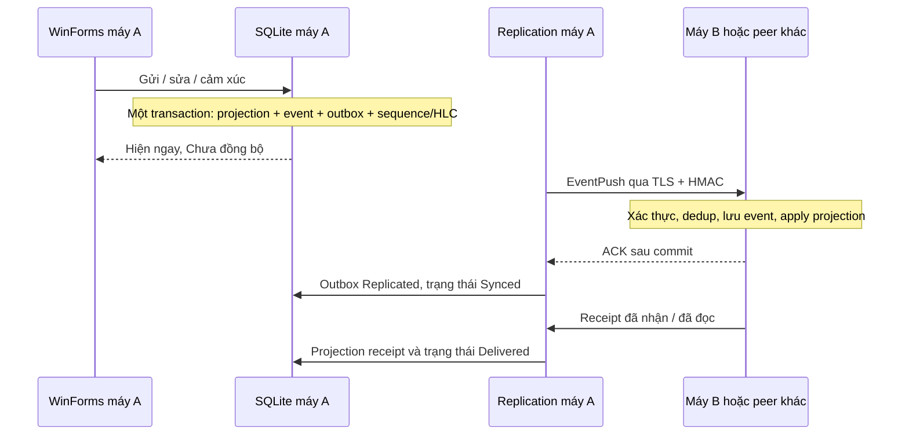

# Kiến trúc và luồng dữ liệu LanChat

## Các tầng

| Project | Vai trò chính |
|---|---|
| LanChat.Domain | Entity Guid, enum, định danh hội thoại trực tiếp, Hybrid Logical Clock |
| LanChat.Application | DTO, hợp đồng chat/replication/consensus/tệp |
| LanChat.Infrastructure | EF Core/SQLite, event store, projection, outbox, TLS/TCP/UDP, Raft, tệp, log |
| LanChat.WinForms | Form/UserControl native, trạng thái giao diện, Generic Host và DI |
| LanChat.Tests | Kiểm thử database, mạng thật, partition, event, tệp và bảo mật |

Form gọi application interfaces; không trực tiếp mở socket hoặc query EF. MainForm được tách phần thao tác nâng cao và harness Debug.

## Hai loại dữ liệu

**Dữ liệu chat** gồm hồ sơ, tin nhắn, sửa/thu hồi, cảm xúc, receipt và metadata tệp. Mỗi node tự ghi được khi offline. Dữ liệu đi qua immutable ReplicationEvent, đồng bộ tăng dần và hội tụ thành projection.

**Dữ liệu điều phối** gồm voter membership và cấu trúc nhóm. Chúng cần thứ tự chung và quorum; đi qua ControlLog của ConsensusService. System message về thay đổi nhóm được tạo từ control command đã commit, với Guid xác định từ command. Chúng không bị phát lại thành chat event thứ hai.

## Gửi một tin nhắn

Chat không cần chờ leader. Máy điều phối được ưu tiên khi gửi, nhưng mọi peer có thể trao đổi trực tiếp. ACK “đã đồng bộ” chỉ chứng minh ít nhất một peer giữ bản sao; chưa có bản sao nào thì dữ liệu vẫn chỉ an toàn bằng ổ đĩa local.

Outbox retry theo backoff, tối đa 30 giây. Reconciliation tự chạy mỗi 25 giây hoặc khi có outbox đến hạn. Tối đa 4 peer được đồng bộ đồng thời để peer chết không chặn mọi peer khác.

## Nhận và khôi phục lịch sử

1. HMAC xác thực event; unique index theo Id và OriginNodeId/OriginSequence chống lặp.
2. Cùng identity nhưng payload khác bị từ chối. Trigger SQLite cấm UPDATE/DELETE event đã lưu.
3. Projection của entity được tính theo PhysicalTicks, LogicalCounter, OriginNodeId, EventId.
4. Cursor chỉ tiến qua sequence liên tục; nhận số 8 trước số 7 không được báo đã có đến 8.
5. Trao đổi Digest, lấy các khoảng thiếu theo từng origin, tối đa 100 event và giới hạn byte mỗi lô.
6. Receipt và event mới sinh trong lúc tiếp nhận được phát tiếp như event bình thường.

Node mới nhận cả lịch sử A/B từ bất kỳ peer nào còn giữ chúng; không cần máy gửi gốc online. Control log được leader truyền riêng cho learner trước khi thêm nó thành voter. UI chỉ hiển thị hội thoại mà local user là thành viên; toàn bộ lịch sử vẫn có trong database theo yêu cầu mô hình.

Recall là trạng thái cuối, thắng các edit đến muộn. Edit chỉ của người gửi; cảm xúc là trạng thái cuối theo user/emoji. Read receipt tăng một chiều. Xóa phía tôi không phát event. HLC xác định thứ tự tin; local read state theo từng tin tránh bỏ sót tin đến muộn có thời gian cũ.

FTS5 với unicode61/remove_diacritics=2 là chỉ mục tìm nội dung. Trigger cập nhật chỉ mục khi text thay đổi; query loại tin đã thu hồi/xóa local và hội thoại không thuộc người dùng. Chọn kết quả tải cửa sổ 101 tin quanh kết quả, không tải toàn lịch sử vào UI.

## Điều phối, quorum và chia cắt mạng

ConsensusService triển khai cơ chế Raft cho control plane:
- Persist CurrentTerm, VotedForNodeId, log, CommitIndex và LastAppliedIndex.
- Một phiếu mỗi term; chỉ bỏ phiếu cho candidate có log đủ mới.
- Timeout mặc định 15 giây cộng jitter; probe leader, kích hoạt discovery, chờ ngẫu nhiên rồi election.
- AppendEntries/heartbeat mỗi 2 giây; truyền song song để một peer chết không kéo dài mọi heartbeat.
- Leader thêm no-op trong term mới; chỉ commit trực tiếp mục của term hiện tại khi có quorum.
- Peer mới nhận log như learner; thêm từng voter qua JointMembership rồi FinalMembership.
- Joint consensus cần majority cả tập cũ lẫn tập mới; denominator không dựa trên số máy đang online.
- Không sửa/xóa log đã commit. Xung đột chỉ có thể thay suffix chưa commit.

Một leader cũ bị cô lập có thể vẫn mang Role=Leader, nhưng HasQuorum hết hiệu lực và không commit thay đổi nhóm. Phía đa số bầu leader term cao hơn; khi nối lại, node cũ step down và đồng bộ log. Chat vẫn ghi local ở cả hai phía rồi merge.

Cấu hình khởi đầu chứa BootstrapNodeId trong mã mời, không dựa vào “máy nào online đầu tiên”. Hai voter cần cả hai; ba voter chịu được một voter offline. Không tự giảm membership vì mất kết nối. Chưa có UI loại voter, snapshot/compaction hoặc phục hồi cưỡng bức khi mất đa số vĩnh viễn.

Tham khảo thuật toán: [Raft paper](https://raft.github.io/raft.pdf). Việc có kiểm thử không tương đương chứng minh hình thức cho mọi interleaving của một distributed system.

## Tệp

ImportLocalAsync copy streaming vào tệp tạm, tính SHA256 và lưu theo hash dưới Data/Attachments. MessageCreated chỉ chứa metadata. Khi bấm tải: kiểm tra local → hỏi FileAvailability → tải TLS trực tiếp từ nguồn → kiểm tra size/SHA256 → atomic rename.

Buffer 64 KB, idle timeout, cancellation và progress; tệp hỏng hoặc đứt giữa chừng không được công bố thành bản hoàn chỉnh. Thử peer tiếp theo nếu nguồn lỗi. Máy đã tải có thể phục vụ lại cho máy khác. Binary không tự replicate; không có nguồn thì giữ nguyên metadata.

Preview trước gửi là local thumbnail; menu File giữ AttachmentForm để xem ảnh và lưu thành. Bấm tệp không phải ảnh trong tin nhắn gọi PrepareOpenAsync: dùng lại bản mở local, hoặc kiểm tra/tải blob rồi tạo bản có tên và phần mở rộng gốc dưới Attachments/Open/<AttachmentId>. WinForms dùng Windows shell mở bản này bằng ứng dụng mặc định. Chỉ mở ứng dụng ngoài theo thao tác bấm của người dùng; nhận metadata không tự mở ứng dụng.

Bản mở tách khỏi blob theo hash để Word/Excel có thể sửa local mà không làm hỏng nguồn P2P. Lần bấm sau giữ nguyên sửa đổi local. Copy streaming qua tệp tạm rồi rename, xử lý tên không hợp lệ và tách thư mục theo attachment để các tệp trùng tên không ghi đè nhau. UI bỏ qua bấm trùng khi đang chuẩn bị, hiện progress/hủy nếu quá 350 ms, và thông báo khi Windows chưa có ứng dụng mặc định.

**Ảnh trong chat:** MessageBubble tạo ImageThumbnailControl cho JPEG/PNG/GIF/BMP/TIFF. Khi control nằm trong vùng hiển thị, ChatImageService chủ động gọi DownloadAsync để lấy blob local đã kiểm tra hash, rồi giải mã/tạo thumbnail trên tác vụ nền; không tải ảnh chỉ vì nhận metadata. Giới hạn hai tác vụ đồng thời, tự tải thumbnail cho tệp tối đa 20 MB; giải mã tối đa 100 MB/40 megapixel và xử lý EXIF orientation. Bitmap thuộc control và được giải phóng khi đổi cuộc trò chuyện/đóng cửa sổ.

Bấm ảnh truy vấn metadata ảnh thuộc cuộc trò chuyện (loại tin thu hồi/xóa phía tôi), lấy nội dung tin làm caption và sắp xếp theo HLC. ImageGalleryForm hiển thị từng ảnh trong ImageViewportControl (fit, 100%, zoom theo vị trí con trỏ, pan), kèm caption, số thứ tự và tối đa chín thumbnail lân cận; nút/phím mũi tên duyệt toàn bộ danh sách. Chuyển ảnh hủy tác vụ cũ, kiểm tra generation trước khi gán bitmap để kết quả cũ không ghi đè ảnh mới. Caption dùng Message.Text hiện có nên không đổi schema/protocol. Nút Ứng dụng ngoài sử dụng PrepareOpenAsync như tệp thường.

## Bảo mật và lưu trữ

Protocol version 2, frame tối đa 4 MB, request correlation, HMAC-SHA256, replay/freshness check. TCP TLS 1.2/1.3 pin certificate theo mã mời. Cert dùng chung có khóa riêng được DPAPI bảo vệ local; Windows Schannel dùng UserKeySet cho private key. [Tài liệu SslStream troubleshooting](https://learn.microsoft.com/en-us/dotnet/core/extensions/sslstream-troubleshooting).

Đây là cluster tin cậy dùng chung credential, không phải mutual identity riêng từng node, Byzantine consensus hay E2EE cho từng hội thoại. UDP metadata không mã hóa; SQLite/tệp local cũng không mã hóa.

Một tiến trình giữ instance.lock cho mỗi thư mục dữ liệu. BuildHost từ chối UNC, mapped network drive và thư mục liên kết. EF migration, WAL, unique indexes và write semaphore giữ transaction tuần tự trong node. Migration từ Phase 1 giữ identity và bổ sung event cho tin cũ, bỏ qua system message từ control log.

## Đọc mã theo nghiệp vụ

| Nghiệp vụ | File chính |
|---|---|
| Ghi local, identity, danh bạ | src/LanChat.Infrastructure/ChatStore.cs |
| Event/cursor/outbox | ChatStore.Replication.cs |
| Projection, chỉnh sửa, tìm kiếm, metadata | ChatStore.Projections.cs |
| Anti-entropy | ReplicationBackgroundService.cs |
| Election/log/quorum/membership | ConsensusService.cs |
| Quyền và projection nhóm | ConsensusService.Groups.cs |
| Wire/TLS/file stream | Networking.cs, ClusterTls.cs, PeerFileTransferService.cs |
| Discovery/fallback | BackgroundServices.cs |
| Mã mời/DI/nâng cấu hình | Bootstrap.cs |
| Chat controls và preview | src/LanChat.WinForms/Controls/ChatControls.cs, AttachmentPreviewControl.cs |
| Nhóm/tệp/tìm kiếm/chẩn đoán | src/LanChat.WinForms/Forms/*Form.cs |
