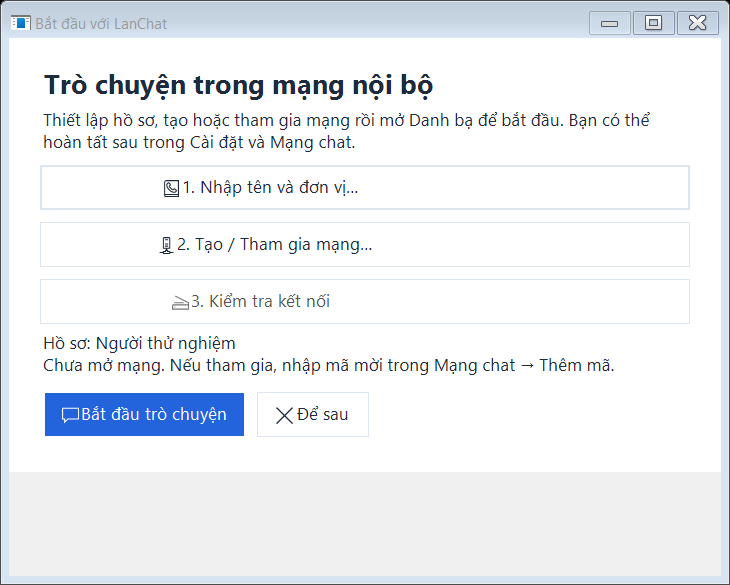
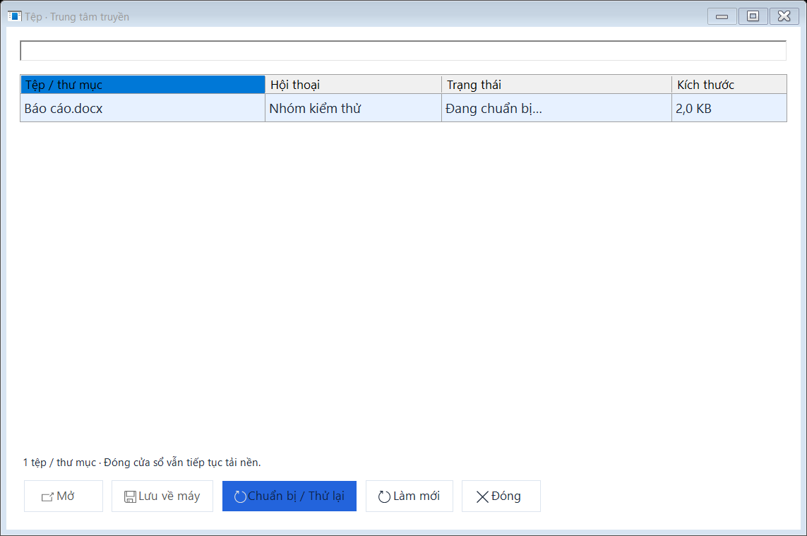
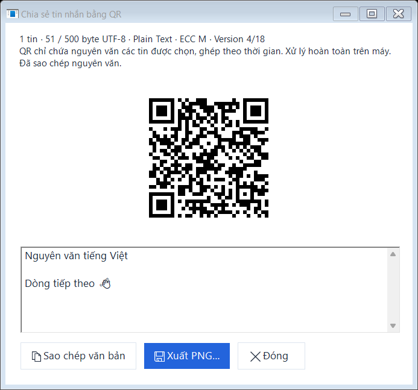

# Hướng dẫn sử dụng LanChat

Trong LanChat, mở **Giới thiệu → Hướng dẫn sử dụng** để đọc tài liệu này khi không có Internet.

## Cài đặt và kết nối lần đầu

1. Từ trang GitHub Releases của LanChat, tải và chạy **LanChat-Setup-Windows-x64.exe** trên Windows 10 hoặc Windows 11 x64.
2. Mở **Cài đặt**, sửa **Tên** và **Đơn vị**. Tên hiển thị theo thứ tự đơn vị rồi đến tên người dùng.
3. Nếu đã được cấp mã, mở **Mạng chat**, dán mã vào ô **Mã tham gia**, rồi bấm **Thêm mã**. Có thể dán nhiều mã, mỗi mã một dòng.
4. Nếu bắt đầu mạng mới, chọn **Mạng chat → Tạo mạng**. Chọn mạng vừa tạo, mở **Chi tiết → Hiện mã mời tham gia**, sao chép mã và gửi riêng cho những người được phép tham gia.
5. Các máy dùng cùng mã và có đường kết nối đến nhau trong LAN sẽ xuất hiện trong **Danh bạ**. Chọn **Quét tất cả** khi cần tìm lại máy.

Mỗi tab tương ứng với một mạng. Khi gỡ mạng rồi nhập lại đúng mã, LanChat có thể mở lại dữ liệu đã lưu trên máy đó. Bản cài nội bộ có thể được cấp sẵn một mạng mặc định.

## Nhắn tin riêng và theo nhóm

1. Chọn người dùng trong **Danh bạ** hoặc mở tin nhắn từ danh sách hội thoại. Dùng **Ctrl+K** để tới ô tìm hội thoại.
2. Nhập tin, nhấn **Enter** để gửi hoặc **Shift+Enter** để xuống dòng. Ô nhập tự giãn theo chữ quấn và xuống dòng, tối đa 8 dòng; khi cửa sổ nhỏ hoặc nội dung dài, cuộn trong ô nhập. Tin được lưu trên máy và sẽ tiếp tục gửi khi kết nối trở lại.
3. Để tạo nhóm chat, mở **Nhóm → Nhóm mới**, tích chọn thành viên rồi bấm **Tạo nhóm**.
4. Trong **Nhóm**, chọn nhóm để xem dấu tích cạnh từng thành viên ở cột **Thành viên nhóm**. Bạn cũng có thể mở **Tin nhắn → chọn nhóm → Thông tin → Thành viên**. Ở cả hai nơi, chủ nhóm có thể tích để thêm, bỏ tích để bớt rồi bấm **Lưu thành viên**. Thay đổi thành viên cần đủ số máy điều phối của mạng.

Khi mạng thiếu phiếu và chỉ hai máy kết nối được với nhau, LanChat chọn một máy điều phối. Nếu cả hai máy chạy v1.2.3 trở lên, bạn có thể tạo nhóm mới cho hai người và chat ngay. Việc sửa nhóm đã có vẫn cần đủ phiếu. Khi đủ phiếu và máy tạo nhóm đang kết nối, nhóm mới được ghi vào nhật ký chung để các máy v1.2.2 nhận được.

Từ v1.2.5, các máy thành viên tự đồng bộ lịch sử nhóm sau khi kết nối. Chỉ cần một máy thành viên còn giữ và đọc được lịch sử đang trực tuyến, các thành viên hiện tại có thể nhận lại tin cũ, kể cả khi người gửi gốc đã tắt máy. Danh sách thành viên cần được đồng bộ trước. Hãy cập nhật các máy trong nhóm lên v1.2.5 để nhận đầy đủ lịch sử. Tệp và thư mục đính kèm tự tải về khi còn máy giữ bản gốc đang trực tuyến.

Nhấp phải hội thoại để ghim, tắt thông báo hoặc **Xóa hội thoại phía tôi**. Thay đổi này áp dụng trên máy của bạn. Bấm thông báo Windows để mở hội thoại tương ứng.

## Nhắc tên trong nhóm

- Gõ **@**, tìm theo tên có hoặc không dấu rồi chọn từ gợi ý. Đơn vị và tên máy giúp phân biệt người trùng tên. Mũi tên di chuyển; **Enter** chọn gợi ý trước khi gửi; **Esc** đóng gợi ý.
- Chọn **@All** để nhắc tất cả thành viên tại lúc gửi. Mọi thành viên nhóm đều được dùng. Người được nhắc thấy tên mình tô xanh và thông báo **đã nhắc tới bạn**, kể cả khi nhóm đã tắt thông báo; hội thoại có dấu **@** cho lời nhắc chưa đọc.
- Chữ @ tự nhập/dán mà không chọn gợi ý chỉ là văn bản. Sửa vào bên trong tên đã chọn làm mất liên kết; hãy chọn lại từ gợi ý. Email không tạo lời nhắc.
- Bấm thông báo để đến đúng tin. Đang đọc ở cuối hội thoại sẽ không bật toast; sửa tin cập nhật phần tô xanh nhưng không thông báo lần nữa. Các máy cũ vẫn đọc chữ @ nhưng cần v1.2.8 để nhận thông báo nhắc tên.

## Chuyển tiếp nhiều tin đến nhiều người

- Menu **Chuyển tiếp** mở toàn bộ danh bạ của mạng đang chọn, kể cả người chưa từng nhắn và đang offline. Có tab **Nhóm** để chọn nhóm hiện có. Tích nhiều người/nhóm; tìm theo tên, đơn vị hoặc máy vẫn giữ dấu tích.
- Muốn chuyển tiếp nhiều tin, bấm **Chọn nhiều** trên tiêu đề chat, tích tin rồi bấm **Chuyển tiếp**. Tin gửi theo thứ tự lịch sử. Giới hạn 500 byte chỉ áp dụng cho QR.
- Danh sách kết quả cho biết từng người/từng tin **Đã lưu chờ gửi**, lỗi hoặc đã hủy. Ngoại tuyến có thể chờ gửi; trạng thái này chưa xác nhận người nhận đã nhận. Nếu thiếu khóa, cần người nhận mở LanChat để đồng bộ khóa.
- **Hủy lượt** dừng phần chưa gửi và giữ phần đã lưu. **Thử lại mục chưa gửi** chỉ gửi phần chưa hoàn tất. Bản nháp và hội thoại đang xem được giữ. Chuyển tiếp chữ @ không tạo lời nhắc mới.

## Trả lời và tìm tin cũ

- Bấm biểu tượng dấu trích dẫn trên tin nhắn để trả lời. Bấm biểu tượng trái tim để chọn cảm xúc. Menu chuột phải có thêm các thao tác như sao chép, chuyển tiếp, sửa và thu hồi.
- Khi chọn **Chuyển tiếp** cho tin có ảnh, tệp hoặc thư mục, LanChat chuẩn bị bản gốc trên máy trước khi gửi. Thư mục được kiểm tra cả các tệp bên trong. Có thể bấm **Hủy** nếu quá trình tải mất thời gian. Nội dung chuyển tiếp dùng bản gốc đã nhận, kể cả khi bạn đã chỉnh sửa bản mở trên máy.
- Bấm khung trích dẫn trong tin trả lời để tới tin gốc. Có thể chọn khung bằng bàn phím rồi nhấn **Enter**. Với tin gốc đã thu hồi hoặc bị xóa phía bạn, khung báo trạng thái của tin.
- Bấm **Quay về tin nhắn mới** để trở lại cuối hội thoại. Bản nháp được giữ khi bạn xem tin cũ.
- Khi **Sửa** tin nhắn, bản nháp trước đó được giữ, gồm cả ảnh, tệp và tin đang trả lời. Hủy sửa hoặc lưu sửa thành công sẽ khôi phục bản nháp đó. Nếu gửi lỗi, nội dung vẫn còn để thử lại.
- Dùng **Tìm tin** hoặc **Ctrl+F** trong hội thoại. Chọn một kết quả để mở vị trí của tin trong lịch sử.

## Gửi ảnh, tệp và thư mục

- Chọn **Đính kèm → Thêm tệp** hoặc **Thêm thư mục**. Hộp thoại chọn thư mục của Windows cho phép nhập đường dẫn. Bạn cũng có thể kéo ảnh, tệp hoặc thư mục từ Explorer vào ô soạn tin.
- Chọn **Dán ảnh** để lấy ảnh trong bảng nhớ tạm. **Ctrl+V** dán ảnh khi bảng nhớ tạm chỉ có ảnh. Khi có cả chữ và ảnh, **Ctrl+V** dán chữ.
- Chọn **Chụp vùng** để tạm ẩn LanChat. Kéo chuột chọn vùng, rồi nhả chuột để chụp. Nhấn **Esc** để hủy. LanChat hiện lại sau cả hai thao tác.
- Ảnh dán hoặc chụp xuất hiện dưới dạng PNG trong bản nháp. Kiểm tra bản xem trước, gỡ tệp nếu cần, rồi bấm **Gửi**. Mỗi tin có thể đính kèm tối đa 20 mục.
- Khi gửi hoặc nhận tin, LanChat tự tải ảnh, tệp và toàn bộ nội dung thư mục về nền, kể cả khi bạn đang xem hội thoại khác. Bấm tên tệp hoặc thư mục để mở bản đã chuẩn bị trên máy. Nếu máy giữ tệp đang ngoại tuyến, ứng dụng tự thử lại và tiếp tục kiểm tra tệp còn thiếu khi mở lại LanChat.
- Khi Mở/Lưu mất thời gian, hộp tiến độ phân biệt chờ tác vụ, chờ máy nguồn, tải, kiểm tra và chuẩn bị. Có thể Hủy; nếu còn người khác chờ, lượt chuẩn bị chung vẫn tiếp tục. Nguồn không trả lời sẽ hết hạn để thử nguồn khác; không thay đổi phần mềm bảo vệ Windows.
- Bấm ảnh trong tin nhắn để xem lớn. Dùng phím mũi tên để chuyển ảnh, cuộn chuột để phóng to và nhấn **Esc** để đóng.

Khi danh sách nội dung thư mục đã có trên máy và được xác minh, trung tâm truyền hiển thị tổng dung lượng và số tệp. Dấu **—** nghĩa là chưa xác định. Đóng trung tâm truyền vẫn cho phép tải nền tiếp tục.

## Lưu đính kèm và mở lại bản đã sửa

- **Mở** cạnh mỗi tệp, thư mục hoặc ảnh dùng ứng dụng mặc định của Windows; thư mục mở trong Explorer. Bấm trực tiếp tên tệp/thư mục vẫn mở như trước, còn bấm ảnh vẫn vào khung xem LanChat với ảnh gốc của tin nhắn.
- **Lưu về máy** lưu bản đang làm việc, gồm các chỉnh sửa bằng Word, Excel hoặc trình sửa ảnh. Tệp dùng hộp thoại chọn tên và nơi lưu, giữ đầy đủ tên nhiều dấu chấm như **abc.z.exe**. Chấp nhận tên gợi ý sẽ giữ nguyên đuôi; Windows hỏi trước khi ghi đè. Thư mục dùng hộp thoại chọn nơi lưu, rồi giữ nguyên thư mục con và nội dung đang làm việc. Dòng trạng thái và tooltip hiển thị vị trí đã lưu.
- Lần lưu đầu chuyển bản làm việc của LanChat ra vị trí đã chọn. Nếu lưu tiếp sang nơi khác, ứng dụng tạo bản sao mới và giữ bản đã lưu trước. Từ đó, **Mở** luôn dùng vị trí mới nhất, kể cả khi khởi động lại. Đóng tệp trong ứng dụng khác nếu Windows báo tệp đang bận, rồi thử lưu lại.
- Với tin có nhiều đính kèm, mở menu **… → Lưu tất cả đính kèm của tin…**. Chỉ chọn thư mục một lần cho cả ảnh, tệp và thư mục của tin đó. Trong khung xem ảnh, menu **… → Lưu tất cả ảnh của tin…** chỉ lưu ảnh cùng tin với ảnh đang chọn. Các thao tác tương ứng cũng có ở bảng **Thông tin hội thoại** và cửa sổ xem tệp.
- Lưu hàng loạt tự thêm `(2)`, `(3)` nếu trùng tên; nếu đích đúng là bản đang dùng thì giữ nguyên. Có thể **Hủy** trong cửa sổ tiến độ. Những mục đã lưu được giữ; lỗi một mục không ngăn các mục còn lại. Cửa sổ kết quả ghi rõ vị trí hoặc lỗi của từng mục. Lưu không tự mở tệp.
- Nếu bản đã lưu bị mất hoặc ổ đĩa chưa kết nối, chọn **Tìm lại tệp/thư mục…**, **Tạo lại từ bản gốc** hoặc **Hủy**. Tìm lại giữ các chỉnh sửa của bản bạn chọn. Tạo lại chỉ lấy nội dung gốc trong tin nhắn và không thể phục hồi chỉnh sửa cục bộ đã mất. Ứng dụng giữ vị trí cũ cho đến khi bạn chọn cách xử lý.
- Bản gốc dùng để đồng bộ, chuyển tiếp và xem ảnh trong chat được giữ riêng. Muốn chia sẻ nội dung đã sửa, đính kèm lại tệp thành tin mới. Khi sao lưu dữ liệu, sao lưu thêm các bản làm việc đã lưu bên ngoài thư mục LanChat.

## Chọn nhiều tin và xuất QR

1. Bấm **Chọn nhiều** trên tiêu đề chat. Tích checkbox của các tin cần chia sẻ. Tin đã thu hồi có checkbox bị khóa.
2. **Chọn tất cả** chọn các tin trong phần lịch sử đang hiển thị; tải thêm tin cũ nếu cần. **Bỏ chọn** xóa lựa chọn và giữ chế độ. **Hủy chọn** hoặc **Esc** thoát chế độ; bản nháp được giữ. Chuyển hội thoại sẽ hủy lựa chọn.
3. Dòng trạng thái hiển thị số tin và dung lượng UTF-8, tối đa **500 byte**, gồm cả dấu phân cách. Khi vượt giới hạn, **Xuất QR** bị khóa; bỏ chọn bớt tin để tiếp tục. Ứng dụng không tự cắt hoặc thay đổi nội dung.
4. Bấm **Xuất QR** để xem mã và văn bản sẽ chia sẻ. Văn bản ghép theo thời gian tăng dần bằng hai dấu xuống dòng LF, không thêm metadata. QR dùng Plain Text UTF-8, sửa lỗi M, tối đa Version 18, không có BOM.
5. Chọn **Xuất PNG…**, nhập nơi lưu và tên tệp. Hộp thoại Windows hỏi trước khi ghi đè. Không tự mở hay gửi ảnh QR ra ngoài. Tạo và xuất QR hoàn toàn trên máy, không dùng dịch vụ bên ngoài.

## Cập nhật và thoát ứng dụng

Mở **Cài đặt → Cài đặt cập nhật**, hoặc nút cùng tên trong **Giới thiệu**. Cấu hình áp dụng cho toàn ứng dụng và được giữ khi mở lại:

- **Online — GitHub** cần Internet. Tự kiểm tra tối đa một lần trong 24 giờ; có thể bấm kiểm tra thủ công.
- **Máy trong LAN** hoạt động offline. Chọn mạng chat đang kết nối, rồi chọn **Tên · Đơn vị · Tên máy**. Nếu chưa thấy máy, quét mạng hoặc bật **Nhập IP và cổng (nâng cao)**, nhập IPv4 và cổng TCP của máy nguồn. Bấm **Kiểm tra kết nối** trước khi lưu. LanChat ghi nhớ định danh máy và khóa đã ghim, nên trùng tên không làm chọn nhầm máy. Nếu IP đổi, ứng dụng ưu tiên địa chỉ mới đã tìm thấy của cùng máy. Nếu nguồn chưa bật chia sẻ, chưa hỗ trợ tính năng hoặc không kết nối được, giữ cấu hình và thử lại sau; không tự chuyển nguồn.
- **Bộ cài trên máy này** dùng EXE bộ cài LanChat đã có. Chọn tệp để kiểm tra thông tin sản phẩm, phiên bản và dung lượng. LanChat tạo bản riêng, giữ nguyên tệp bạn chọn; chỉ cho cài phiên bản mới hơn máy đang dùng.

Muốn một máy cung cấp cập nhật cho các máy khác, bật **Máy này cung cấp cập nhật qua LAN**, chọn bộ cài và tích các mạng được phép nhận. Khi bật, mạng đang sử dụng được chọn sẵn để bạn xác nhận. Chia sẻ mặc định tắt và độc lập với nguồn cập nhật: máy nguồn có thể kiểm tra GitHub hoặc tự cài gói trên máy này. Gói bằng phiên bản máy nguồn vẫn chia sẻ được cho máy cũ hơn. Giữ LanChat và mạng được chọn đang chạy; chỉ các máy cùng mạng chat mới nhận được bộ cài. Cả hai máy cần phiên bản hỗ trợ cập nhật LAN; máy v1.2.6 trở về trước cần cài bản mới bằng EXE hoặc GitHub trước.

Máy nhận tin cậy bộ cài do máy nguồn đã chọn cung cấp. Chữ ký thiết bị xác minh đúng máy nguồn, còn SHA-256 kiểm tra tệp truyền nguyên vẹn; chúng không xác nhận bộ cài có nguồn gốc GitHub. Tối đa bốn máy tải cùng lúc. Khi thay bộ cài, lượt tải đang chạy tiếp tục dùng bản cũ; lượt chưa bắt đầu cần kiểm tra lại. Máy nguồn phải chờ tải xong trước khi tự cài hoặc thoát. Khi đang kiểm tra, tải hoặc xác minh, hoàn tất/hủy tác vụ trước khi lưu thay đổi nguồn.

1. LanChat tự kiểm tra cập nhật khi khởi động và tiếp tục kiểm tra trong lúc chạy. Khi có bản mới hơn, ứng dụng tự tải nền và hiện chấm badge trên nút **Giới thiệu**. Bạn vẫn có thể mở **Giới thiệu → Kiểm tra cập nhật** để kiểm tra ngay. Kết quả, tiến độ và các nút cập nhật luôn đồng bộ với cửa sổ chính.
2. Bạn có thể đóng Giới thiệu để tiếp tục chat trong lúc tải nền, hoặc chọn **Hủy tải**. Mở lại Giới thiệu sẽ thấy tiến độ hiện tại. Nếu tải lỗi hoặc đã hủy, có thể tải lại.
3. Tải xong, LanChat kiểm tra kích thước và SHA-256 rồi chờ bạn chọn **Cài đặt ngay**. Hoàn tất hoặc hủy tác vụ đang chạy, xử lý bản nháp theo lời nhắc để tiếp tục. Ứng dụng xác minh lại bộ cài trước khi thoát để cài đặt.
4. Mở lại **Giới thiệu** sau khi cài để đối chiếu phiên bản. Có thể cài thủ công EXE từ GitHub Releases bằng cùng tài khoản Windows đang dùng LanChat.

LAN và bộ cài cục bộ được kiểm tra mỗi phút, khi khởi động, sau khi áp dụng cấu hình hoặc khi bấm kiểm tra. GitHub được kiểm tra tự động tối đa một lần trong 24 giờ. Bộ cài đã tải và xác minh vẫn có thể cài khi nguồn ngoại tuyến. Ứng dụng chỉ cài khi bạn nhấn **Cài đặt ngay** và giữ nguyên nguồn cập nhật đã chọn. Nhắn tin và truyền tệp giữa những máy đã kết nối sử dụng mạng nội bộ. Nút **X** hoặc **Thu nhỏ** đưa ứng dụng xuống khay hệ thống. Nhấp đúp biểu tượng để mở lại hoặc nhấp phải rồi chọn **Thoát LanChat**.

Các hộp thoại có nút **Hủy/Đóng** và hỗ trợ **Esc**. Khi có tác vụ ghi đang chạy, chờ hoàn tất trước khi đóng. Ứng dụng hỏi trước khi bỏ nội dung chưa lưu; bản nháp chỉ được giữ trong phiên làm việc hiện tại. Nếu bấm thông báo tin nhắn lúc đang mở hộp thoại, LanChat đưa hộp thoại lên trước và chuyển tới tin nhắn sau khi bạn đóng hộp thoại đó.

## Khi không thấy máy hoặc cần sao lưu

- Kiểm tra các máy đang chọn đúng tab mạng và có cùng mã. Máy tạo mạng nên mở LanChat trong lần kết nối đầu tiên.
- Bấm **Quét tất cả**. Nếu vẫn chưa tìm thấy, kiểm tra các máy cùng mạng LAN, quyền tường lửa trên mạng tin cậy và cài đặt cô lập thiết bị của Wi-Fi.
- Khi sao lưu, chọn **Thoát LanChat** từ khay hệ thống rồi chép cả thư mục `%LOCALAPPDATA%\LanChat\Data` vào vị trí an toàn. Bản sao lưu có thể chứa dữ liệu chat đã giải mã. Khóa thiết bị gắn với tài khoản Windows hiện tại.

## Bố cục thích ứng và tùy chỉnh hiển thị

Các mục Giới thiệu, cập nhật và hướng dẫn bắt đầu nằm trong menu **Thêm** trên thanh công cụ. Dấu báo phiên bản mới cũng hiển thị trên nút này.

- Cửa sổ hẹp hiển thị riêng danh sách hoặc nội dung chat. Chọn hội thoại để mở; dùng mũi tên quay lại hoặc **Alt+Trái** để về danh sách. Bản nháp được giữ khi đổi kích thước.
- Danh sách có **Tất cả / Chưa đọc / @ Tôi / Đã ghim**. Từ khóa tìm tên và bộ lọc được giữ khi dữ liệu cập nhật.
- Dùng nút **+** cạnh ô nhập để thêm tệp, thư mục, dán ảnh hoặc chụp vùng. **Enter** gửi, **Shift+Enter** xuống dòng, **Ctrl+V** dán, **Esc** hủy trả lời/sửa phù hợp.
- **Tệp** mở trung tâm theo dõi của mạng hiện tại: hội thoại, kích thước, trạng thái và tiến độ có dữ liệu. Chọn tệp rồi **Mở**, **Lưu về máy** hoặc **Chuẩn bị / Thử lại**. Đóng cửa sổ này vẫn tiếp tục tải nền; không có nút hủy truyền.
- **Ctrl+K** tìm nhanh tên/hội thoại; **Ctrl+F** tìm trong hội thoại đang mở; **Ctrl+Shift+F** tìm trong toàn bộ lịch sử được phép truy cập. Chọn kết quả để đến đúng tin. Nút **Dừng** chỉ dừng tìm kiếm.
- Menu **Kết nối** ở cuối cửa sổ cho phép quét **mạng hiện tại**, kiểm tra mạng và xem chẩn đoán. **Quét tất cả** trên thanh công cụ áp dụng cho mọi mạng đang mở. Thiếu máy điều phối không đồng nghĩa mất khả năng nhắn tin.
- **Cài đặt** cho đổi cỡ chữ tin nhắn (10/11/12/14 pt), mật độ (Gọn/Tiêu chuẩn/Thoải mái), giao diện (Sáng/Tối/Theo Windows) và ẩn nội dung trên thông báo. Các thay đổi áp dụng khi lưu và chỉ lưu trên máy này. Một số thành phần do Windows vẽ, như thanh tiêu đề, thanh cuộn và hộp thoại hệ thống, có thể giữ màu hệ thống.
- Cửa sổ QR có **Sao chép văn bản**, giữ nguyên cả xuống dòng và Unicode; **Xuất PNG** vẫn tuân thủ giới hạn 500 byte UTF-8.
- Hướng dẫn bắt đầu dùng lại các màn hình hồ sơ và mạng hiện có. Có thể chọn **Để sau** và mở lại từ menu khay hệ thống.
