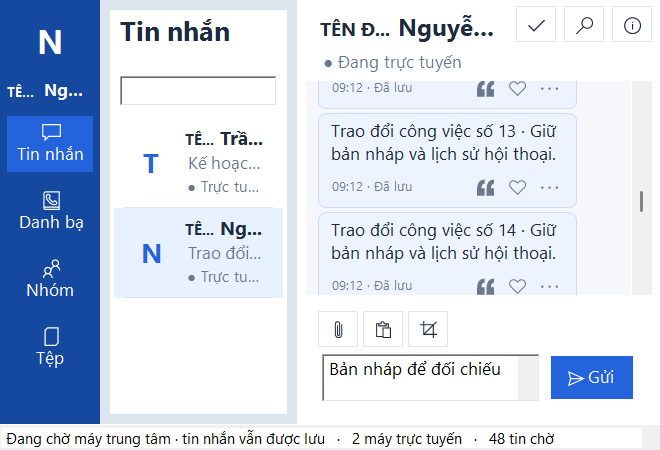
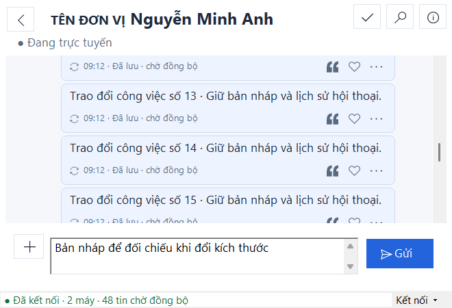
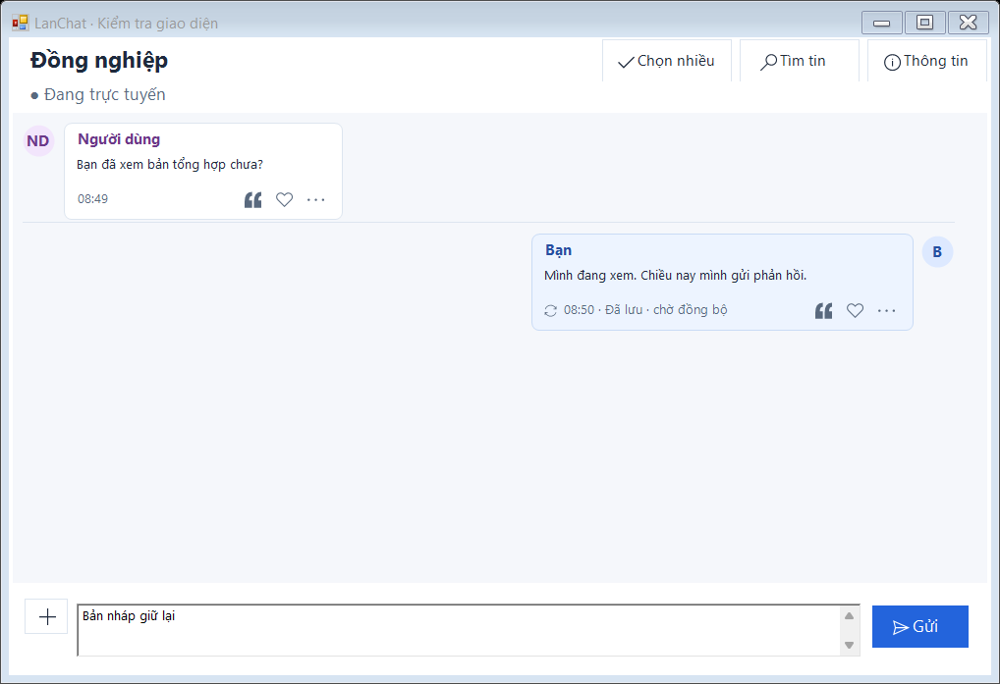
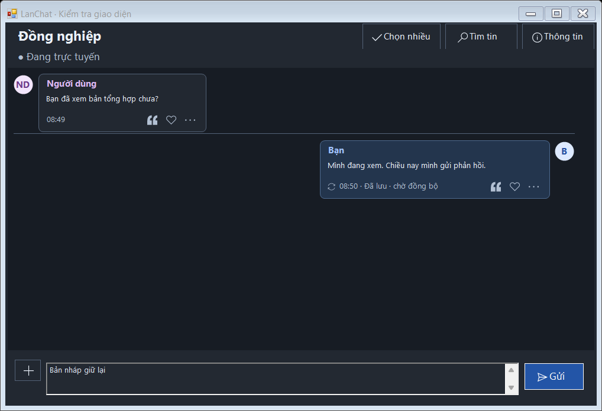

# LanChat — bàn giao nâng cấp UI/UX (20/11/2026)

Đã triển khai các thay đổi UI của P0–P2 trên WinForms/.NET Framework 4.8. Giữ giao thức, Raft, E2EE, TLS, DPAPI, schema, dữ liệu và pipeline publish/ký/cập nhật. Không thêm thư viện UI hoặc Timer. Chưa tuyên bố nghiệm thu toàn bộ: một kịch bản lịch sử nhóm có sẵn vẫn timeout; một số kiểm tra hệ điều hành thực tế và bộ cài ký số còn cần thực hiện.

## 1. Build và kiểm thử

| Kiểm tra | Kết quả / chứng cứ |
|---|---|
| Debug solution | PASS, 0 warning / 0 error; verification/uiux/debug-build.log |
| Release WinForms | PASS, 0 warning / 0 error; verification/uiux/release-build.log |
| Toàn bộ UI tại đợt chốt | 75/75 PASS; ui-accepted/ |
| QR bốn DPI và highlight không dấu sau chỉnh cuối | 7/7 PASS; qr-search-delivery/ (4 QR + 3 highlight) |
| Bộ kiểm thử tuần tự | 218/218 PASS; delivery-sequential/; loại đúng một bài lịch sử nhóm được báo riêng bên dưới |
| Hai tiến trình WinForms thật | A/B Success=true; VerifiedLanUpdate=true; two-processes/A.json và B.json |
| Bộ lọc/chọn hội thoại sau rút gọn dấu trạng thái | 1/1 PASS; conversation-final/ |
| Whitespace | git diff --check không có lỗi whitespace |

Các bài kiểm thử dùng thư mục và dữ liệu giả riêng. Hai tiến trình xác nhận chat riêng/nhóm, 6 tệp/ảnh, mở và lưu bản chỉnh sửa, gallery, trích dẫn, clipboard, thành viên, nhắc tên/chuyển tiếp và truyền bộ cài giả qua LAN. Bộ cài giả không được thực thi. Tiến trình tự đóng.

Sau lượt toàn suite, các thay đổi cuối chỉ thuộc UI: icon trạng thái, callback gallery, QR, highlight và rút gọn dấu ghim/im lặng/@ trong hội thoại. Các phần này có lượt UI, kiểm tra tập trung và hai tiến trình riêng. [Tóm tắt máy đọc](verification/uiux/acceptance-summary.json). Không cộng các lượt lặp thành số bài kiểm thử duy nhất.

Trong lượt khảo sát UI, build kiểm thử dùng -p:LanChatDevelopmentSigning=false vì sandbox không truy cập được chứng thư. Khi phát hành v1.2.10, kiểm tra ngoài sandbox xác nhận chứng thư vẫn có khóa riêng; EXE và bộ cài đã được ký theo pipeline hiện có. Không sửa trust store. Xem [kiểm chứng phát hành](VERIFICATION_V1_2_10_RELEASE.md).

### Lỗi và các lượt đối chứng

- GroupHistoryTests.OneRemainingHolderAutomaticallySharesAllPagesWithCurrentGroupMembers timeout ở GroupHistoryTests.cs:96 khi chờ đủ 215 tin cho hai thành viên mới. Chạy riêng trên mã sửa và HEAD gốc e2056aa0577809c91c304d3db110dd90205d270e đều tái hiện. Chứng cứ: group-history-isolated/ và group-history-baseline/. **Mức trung bình:** chưa nghiệm thu kịch bản khôi phục nhóm lớn chỉ còn một máy giữ lịch sử. Chưa đủ bằng chứng kết luận mất dữ liệu. Không đổi giao thức, quorum hoặc tăng timeout để làm xanh bài này.
- Có một lượt full suite đạt 219/219 (final-tests/). Các lượt song song sau đó có lỗi mạng không ổn định: NetworkStream đã dispose trong LanUpdateTests.ChangedNodeAndTamperedSignatureAreRejected và timeout bàn giao trong DistributedTests.NominationAndWithdrawalKeepVotesAndReplicateQueuedMessages (delivery-tests/). Hai bài này đều PASS trong lượt tuần tự 218/218. Giữ cả báo cáo thất bại, không suy luận nguyên nhân là UI.
- Chạy tuần tự bằng tham số VSTest xUnit.ParallelizeTestCollections=false và xUnit.MaxParallelThreads=1 theo [tài liệu xUnit](https://xunit.net/docs/config-runsettings); không đổi cấu hình test mặc định trong repository.
- Một lượt QR gặp clipboard trống thoáng qua. Fixture cho thử lại tối đa ba lần, vẫn xác nhận handler copy thành công và văn bản đúng nguyên vẹn. Không sửa nội dung clipboard hoặc nới kiểm tra UTF-8 của sản phẩm.

## 2. Thành phần đã nâng cấp

| Hạng mục | Hành vi và phạm vi |
|---|---|
| P0 — Bố cục | Rộng/trung bình/hẹp theo kích thước logic quy đổi DPI; rail 96/60 px, dưới khoảng 800 px chuyển danh sách/chat. Nút quay lại và Alt+Trái. Giữ cùng control, draft, hội thoại và cache. Đặt ô điều hướng tường minh để không chồng khi ẩn hồ sơ. |
| P0 — Điều hướng | Tin nhắn, Danh bạ, Nhóm, Tệp, Mạng chat; tooltip khi rail thu gọn. Mạng trên toolbar chỉ cần khi chưa mở mạng. Thêm gom giới thiệu/cập nhật/hướng dẫn và giữ badge cập nhật. Quét tất cả khác quét mạng hiện tại. |
| P0 — Hội thoại | Tất cả / Chưa đọc / @ Tôi / Đã ghim; tên đậm khi chưa đọc, preview, thời gian riêng, badge, ghim/mute/@. Giữ tìm kiếm/bộ lọc/chọn kể cả khi hội thoại bị lọc ẩn. Bỏ bind khi dữ liệu không đổi và tái sử dụng row. Số đếm bộ lọc có trong AccessibleName. |
| P0 — Trạng thái tin | Icon dùng chung UiIcons, màu, chữ và tooltip. Local pending, synced, delivered, read chỉ dựa dữ liệu thực. Synced không suy ra người nhận đã nhận. Backend chưa có đủ bảy trạng thái độc lập/API retry tin thủ công; không tạo xác nhận giả. Lỗi gửi giữ draft, outbox giữ retry hiện có. |
| P1 — Soạn tin | Một hàng +/editor/Gửi; menu tệp, thư mục, dán ảnh, chụp vùng; giữ preview/context, tự giãn, Enter/Shift+Enter/Ctrl+V/kéo thả/Esc và bản nháp sửa/trả lời. |
| P1 — Trung tâm tệp | Theo từng mạng: tên/hội thoại/trạng thái/kích thước có dữ liệu; mở/lưu/chuẩn bị/thử lại. Ảnh mở bằng gallery cũ. Theo dõi row nhìn thấy qua timer AttachmentActions có sẵn; kiểm tra lại tệp chưa hoàn thành. Đóng chỉ ngừng theo dõi; tác vụ dùng lifetime mạng. Không thêm hủy truyền. Tổng dung lượng thư mục chưa có, hiển thị —. Lỗi nền không có snapshot thì chỉ báo chờ nguồn/chờ tải. |
| P1 — Tìm kiếm | Tìm nhanh tên/đơn vị không dấu dùng hàm có sẵn. Ctrl+F trong hội thoại, Ctrl+Shift+F toàn bộ lịch sử được phép xem; kết quả hai dòng, thời gian, snippet tô từ khóa kể cả không dấu, nút dừng, mở đúng MessageId. Giữ FTS/cancellation/generation, không đổi DB. |
| P1 — Kết nối | Chỉ báo peer thực, đang quét/gián đoạn/lỗi; menu quét mạng hiện tại/kiểm tra/chẩn đoán. Không suy mất khả năng chat từ leader. Chi tiết Raft ở chẩn đoán. Snapshot trạng thái dùng lại trong chu kỳ 500 ms; revision/hiện diện đổi làm mới ngay. |
| P1 — Nhóm | Tìm thành viên không dấu, đếm thay đổi chưa lưu, giữ draft khi lọc, thông báo thiếu máy điều phối. Giữ gate lưu/chờ commit/ngăn nhấn lặp và draft khi thất bại. |
| P1 — QR | Sao chép nguyên văn, bố cục dọc khi hẹp, PNG/đóng. Giữ dung lượng/giới hạn/lỗi sau copy/save. Plain Text UTF-8, 500 byte, ECC M, Version 18, client-only; không cắt văn bản. |
| P1 — Thông báo | Tùy chọn ẩn nội dung; giữ cursor chống lặp, ưu tiên mention, định tuyến đúng mạng/hội thoại/tin và UpdateCoordinator dùng chung. Chính sách mention vượt mute có sẵn được giữ. Chỉ cài cập nhật sau xác nhận. |
| P2 — Khởi đầu | Hướng dẫn một lần dùng lại hồ sơ, tạo/tham gia/mã mời và quét mạng. Cho Để sau; mở lại từ Thêm/khay. Không có cơ chế mời thứ hai hoặc hiển thị secret. Logic tự hiện/bước mạng mới chủ yếu được kiểm tra mã; render/dialog có kiểm thử. |
| P2 — Theme | Màu chữ phụ tăng tương phản, màu trạng thái chung, icon hệ thống thống nhất; không có hiệu ứng hoặc timer mới. |
| P2 — Cá nhân hóa | Cỡ chữ chat 10/11/12/14 pt; mật độ Gọn/Tiêu chuẩn/Thoải mái, áp dụng ngay và giữ mốc đọc/draft. ui-preferences.json cục bộ, không replicate. Dark mode chưa triển khai để tránh native control/màu nền không nhất quán. |
| P2 — Trợ năng | AccessibleName/description, tooltip rail/icon mới, focus row, Enter/Space danh bạ/hội thoại, Alt+Trái và Ctrl+Shift+F. Chưa coi là chứng nhận WCAG hoặc kiểm chứng screen reader toàn bộ. |

## 3. Tệp mã nguồn

Trong src/LanChat.WinForms:

- Controls sửa: AttachmentActions.cs, ChatControls.cs, ContactControls.cs, ConversationPanel.cs, GroupMembersControl.cs, Theme.cs, UiInteraction.cs.
- Forms sửa: AttachmentForm.cs, DpiForm.cs, GroupsForm.cs, MainForm.cs, MainForm.Advanced.cs, MainForm.Verification.cs, MessageSearchForm.cs, NetworkWorkspace.cs, NetworkWorkspace.Updates.cs, QrShareForm.cs, SettingsForm.cs.
- NetworkCatalog.cs.
- Mới: Controls/MessageDeliveryPresentation.cs (có DeliveryStatusLabel), Controls/SearchResultListBox.cs, Forms/TransferCenterForm.cs, Forms/GettingStartedForm.cs, UiPreferences.cs.

Kiểm thử: sửa WindowsUiTests.cs và WindowsCompactWorkspaceTests.cs; thêm WindowsUxTests.cs, WindowsUxWorkflowTests.cs, WindowsUxAppearanceTests.cs, WindowsUxEvidenceTests.cs. Cập nhật HUONG_DAN_SU_DUNG.md.

Không sửa Domain/Application/Infrastructure, migrations, project/target/publish hoặc installer. Danh mục khảo sát trước thay đổi: verification/uiux/source-inventory.txt (102 file C#). Đã đọc kiến trúc, hợp đồng, các luồng UI liên quan và kiểm thử trước khi triển khai; tái sử dụng history cache, FTS, draft, mentions, transfer coordinator, QR và update coordinator có sẵn.

## 4. Ảnh và ma trận kiểm tra

**Trước nâng cấp, cửa sổ rộng 660 px**

**Sau nâng cấp, cửa sổ rộng 660 px**

- [Sau 800](verification/uiux/after/chat-800.png) · [Sau 1280](verification/uiux/after/chat-1280.png).
- [Hai máy thật — giao diện](verification/uiux/two-processes/A.1020.png) · [Nhóm](verification/uiux/two-processes/A.groups.png) · [Thông tin](verification/uiux/two-processes/A.conversation-panel.png).
- [QR 200%](verification/uiux/after/qr-192.png) · [Cài đặt 200%](verification/uiux/after/preferences-192.png) · [Trung tâm tệp](verification/uiux/after/transfer-center.png).
- [Báo cáo A](verification/uiux/two-processes/A.json) · [B](verification/uiux/two-processes/B.json).

Ma trận: 660×450, 800×600, 1024×768, 1280×800, 1920×1080 theo kích thước logic, nhân scale 96/120/144/192 DPI. Các mức DPI này được mô phỏng layout/font, không đổi cấu hình màn hình. DpiForm có test seam scoped vì DeviceDpi của HWND luôn phản ánh monitor thật. Lượt hai máy và benchmark dùng DPI thật 120 (125%). Không đánh đồng mô phỏng với kiểm thử phần cứng ở bốn DPI.

## 5. Hiệu năng

Cùng Windows session/net48, cỡ chữ thực tế 10 pt, dataset và phương pháp: hai hội thoại 24 tin, 12 lượt chuyển ấm; dựng 80 tin và 6 bind ấm. Mỗi bản chạy testhost riêng, nối tiếp, không chạy test khác đồng thời. HEAD gốc được dựng ở thư mục thử riêng, không thay checkout. Cặp sạch cuối đã rebuild để bỏ binary có hook khảo sát.

| Chỉ số — cặp sạch cuối | Trước | Sau |
|---|---:|---:|
| Trung vị chuyển hội thoại | 59,31 ms | 59,65 ms |
| Dựng 80 tin lần đầu, gồm native handles | 1.041,44 ms | 1.096,15 ms |
| Trung vị bind ấm 80 tin | 66,97 ms | 58,96 ms |

Chuyển hội thoại gần như tương đương (+0,33 ms); cold render tăng khoảng 55 ms trong cặp cuối; bind ấm thấp hơn trong cặp cuối. Các lượt khảo sát trước dao động rộng nên không tuyên bố tăng tốc toàn ứng dụng, kết luận thống kê hoặc bảo đảm trên mọi máy/cụm lớn. Chưa đo startup, RAM/CPU. Đã bỏ layout workspace trùng và đọc trạng thái SQLite trùng trong chu kỳ UI; không thêm Timer. Hook phân tách bước đã gỡ khỏi mã bàn giao.

[Số đo tổng hợp và mẫu thô](verification/uiux/performance-comparison.json); toàn bộ lượt khảo sát được giữ trong measurements/. Các kết quả có hook chỉ dùng chẩn đoán, cặp CleanRebuiltPair là phép đo bàn giao.

## 6. Phần còn lại

1. **Trung bình:** timeout khôi phục lịch sử nhóm lớn có sẵn, đã đối chứng trên mã gốc; chưa sửa backend hoặc tuyên bố nghiệm thu kịch bản này.
2. **Chưa triển khai:** dark mode nhất quán toàn bộ WinForms.
3. **Cần PC nghiệm thu:** Windows 10/11 với bốn DPI thật, đổi monitor, IME, Narrator và toast hệ điều hành. Phần định tuyến notification giữ cơ chế cũ, riêng tư được kiểm thử qua incoming-notice UI path; chưa tự động bấm toast Windows thật.
4. **Phát hành cập nhật:** publish và ký bộ cài đã được thực hiện cho v1.2.10. Chưa cài vào dữ liệu thật của người dùng và chưa benchmark startup/RAM/CPU/cụm lớn.

## 7. Tái chạy và tài liệu tham chiếu

- Build: dotnet build LanChat.sln --no-restore -m:1 -p:UseSharedCompilation=false -p:LanChatDevelopmentSigning=false.
- Suite tuần tự: dotnet test tests/LanChat.Tests --no-build --no-restore --filter FullyQualifiedName!~OneRemainingHolderAutomaticallySharesAllPagesWithCurrentGroupMembers -- xUnit.ParallelizeTestCollections=false xUnit.MaxParallelThreads=1. Bài bị loại phải chạy riêng và vẫn báo cáo kết quả.
- Hai máy: pwsh -NoProfile -File scripts/Verify-TwoInstances.ps1 -WithLanUpdate -OutputDirectory <thư-mục-thử-mới>.
- LANCHAT_UI_CAPTURE_DIR điều khiển nơi lưu ảnh. LANCHAT_UX_EVIDENCE bật fixture CaptureResponsiveWorkspaceAndMeasureConversationSwitches và lưu JSON/screenshot. Không dùng thư mục dữ liệu LanChat thật.
- Tham chiếu thiết kế: [Microsoft responsive layout](https://learn.microsoft.com/en-us/windows/apps/design/layout/screen-sizes-and-breakpoints-for-responsive-design), [WCAG 2.2](https://www.w3.org/TR/WCAG22/), [xUnit VSTest configuration](https://xunit.net/docs/config-runsettings).

## 8. Nâng cấp Trung tâm tệp, gợi ý @ và giao diện sáng/tối

Baseline mã nguồn là `b646034a404ef62deb09cf2c6b9e4d7654aaab86`. Kết quả ở các mục trên thuộc các lượt kiểm chứng cũ. Lượt này dùng Windows x64 build 26300 và .NET Framework 4.8. Chưa tạo commit local.

### Hành vi trước và sau

| Khu vực | Trước | Sau |
| --- | --- | --- |
| Dung lượng thư mục | Hiện dấu — | Hiện tổng dung lượng và số tệp khi manifest cục bộ có SHA-256 đúng, đúng tên và cấu trúc. Hàng đang hiển thị được đọc lần lượt ở nền. Kết quả chỉ giữ ở ô của hàng và lượt đọc lại manifest chưa có được giãn cách. |
| Tiến độ tệp | Có trạng thái chuẩn bị và số KB | Phân biệt tác vụ chờ, kết nối hoặc chờ nguồn, tải theo KB/MB, kiểm tra SHA-256, chuẩn bị, hoàn thành, thiếu bản lưu và lỗi chuẩn bị. Lỗi trong Trung tâm tệp dùng nhãn chung. |
| Ảnh trong hội thoại | Hiện trạng thái tải chung | Thumbnail có nhãn chờ, tải, giải mã và thử lại. Thumbnail vẫn chỉ bắt đầu khi vào vùng nhìn thấy và dùng chung giới hạn hai tác vụ đồng thời. |
| Gợi ý @ | Tối đa bảy hàng, đã có tìm không dấu, cuộn và điều hướng | Giữ hành vi hiện có, giới hạn kích thước theo vùng làm việc quanh trình soạn thảo và chọn đúng hàng được bấm. |
| Giao diện | Palette sáng tĩnh | Sáng, Tối và Theo Windows trong Cài đặt. Lưu cục bộ, cập nhật cửa sổ đang mở, giữ bản nháp và vùng chọn. Cấu hình cũ mặc định Sáng và chế độ tương phản cao của Windows được ưu tiên. |

Manifest summary đọc qua cùng handle vừa được kiểm tra SHA-256. Nó dùng blob cục bộ, có cancellation, chỉ trả số lượng và số byte. Giao diện giữ dấu — khi manifest thiếu hoặc không hợp lệ. Cơ chế chuẩn bị, phục hồi và mở tệp vẫn dùng luồng hiện có. Logic badge, tìm toàn lịch sử và định tuyến thông báo giữ nguyên.

Palette bao gồm nền và văn bản, viền, màu hover/vùng chọn, trạng thái, highlight mention/tìm kiếm, các nút phẳng, tab mạng, menu, lưới và viewer. Thanh tiêu đề, thanh cuộn, phần native của một số control, tooltip và hộp thoại hệ thống có thể dùng màu Windows. Kiểm tra contrast có mẫu bong bóng, nút disabled và nội dung tô sáng. Cần kiểm tra thực tế các bề mặt native trên Windows 10 và 11.

### Phác thảo giờ đã đọc

UI giữ trạng thái đọc hiện tại. `MessageReceipt.ReceivedAtTicks` ghi thời điểm nhận. Timestamp đọc mới, nếu được duyệt, nên ghi lần đọc đầu tiên theo định danh tin và người đọc tại thời điểm thao tác đọc thực sự. Cần kiểm tra sai lệch đồng hồ thiết bị, hợp nhất nhiều thiết bị của một người theo quy tắc xác định và giữ quyền xem receipt hiện tại.

Đề xuất mặc định cho dữ liệu cũ và peer chưa hỗ trợ là hiển thị dấu — cho thời điểm. Trước khi chọn cách truyền dữ liệu, cần kiểm tra khả năng peer v4 xử lý dữ liệu tùy chọn hoặc event lạ, phạm vi lưu trữ và cách rollback. Mọi thay đổi định dạng event, giao thức hoặc schema cần duyệt riêng trước khi triển khai.

### Đo hiệu năng cục bộ

Cùng một harness WinForms Release x64 và dữ liệu tổng hợp. Mỗi cấu hình chạy ba tiến trình mới theo thứ tự luân phiên. Đo sau khi cửa sổ hiện, sau một giây nhàn rỗi, sau khi render 80 tin và sau khi giải mã tám thumbnail từ file cục bộ. Mỗi tiến trình đổi qua lại hai hội thoại 10 lần bằng đường bind/layout của UI. RAM là trung vị private bytes / working set, đơn vị MiB. Thời gian là trung vị tính bằng ms.

| Mốc đo | HEAD sáng | Bản sửa sáng | Bản sửa tối |
| --- | ---: | ---: | ---: |
| Cửa sổ vừa hiện | 24,66 / 40,08 | 24,73 / 40,53 | 24,74 / 40,70 |
| Nhàn rỗi | 25,36 / 41,57 | 25,42 / 42,02 | 25,45 / 42,14 |
| Đọc 80 tin | 39,76 / 60,22 | 39,83 / 60,58 | 40,24 / 61,04 |
| Tám thumbnail đã giải mã | 41,93 / 63,83 | 41,95 / 64,10 | 41,89 / 64,16 |
| Hiện cửa sổ từ lúc vào harness | 115,93 | 121,89 | 124,15 |
| Đổi hội thoại | 11,30 | 11,49 | 12,20 |

Phép đo cô lập UI và giải mã ảnh cục bộ. Khởi động mạng thực, truy vấn lịch sử qua cơ sở dữ liệu, tốc độ tải qua LAN và CPU dài hạn cần phép đo riêng. Dữ liệu thô ở `.codex-temp/ui-ux-1795570876812/performance-*.csv`.

### Kết quả kiểm thử

| Kiểm tra | Kết quả | Bằng chứng |
| --- | --- | --- |
| Build Debug và Release net48 | PASS | Cả hai 0 cảnh báo, 0 lỗi. Ký phát triển tắt cho lượt build. |
| Hồi quy Release trên bản cuối | PASS | 17/17, gồm manifest 0/1/3 tệp, manifest thiếu hoặc sai hash, hủy, popup @ 0/30 và kích thước 1/7/30 ở các DPI mô phỏng, cấu hình cũ/mới, đổi theme giữ vùng chọn/bản nháp, chọn đúng MessageId và dừng tìm kiếm, đóng Trung tâm tệp khi đang tải nền. |
| Suite Debug tuần tự có chụp ảnh | FAIL | 238/243 PASS. Một timeout TCP trong `AWorkingTcpDirectionCanCarryRepliesWithoutUdp` và bốn timeout UI QR/clipboard tại DPI mô phỏng 100/125/150/200%. Sau lượt này, kiểm tra tập trung chạy lại trên bản cuối. |
| Đối chứng timeout TCP trên HEAD sạch | FAIL | Cùng ca và cùng điểm chờ tại `MultiNetworkTests.cs:80`. |
| QR/clipboard chạy riêng | PASS | HEAD Debug 4/4 và bản sửa Release 4/4. Lỗi trong suite có chụp ảnh chưa tái hiện khi chạy riêng. |
| `OneRemainingHolderAutomaticallySharesAllPagesWithCurrentGroupMembers` chạy riêng | PASS | 1/1 trong 47 giây. Tài liệu các lượt cũ ghi nhận timeout khi chờ 215 tin. |
| `Verify-TwoInstances.ps1`, loopback, dữ liệu giả | PASS | A/B đều thành công. Mỗi máy xác nhận 6 tệp/ảnh, 3 yêu cầu mở, 4 gallery, 4 ảnh nội tuyến, sửa nguồn, mở lại bản lưu, trích dẫn, clipboard, thành viên, mention và chuyển tiếp. |
| Kiểm tra whitespace | PASS | `git diff --check`. |
| Click balloon/tray thật, IME trực tiếp, nhiều màn hình/DPI vật lý và Windows 10 | CHƯA CHẠY | Ảnh và test DPI được mô phỏng trên phiên Windows hiện tại. |
| Cập nhật LAN và bộ cài | CHƯA CHẠY | Harness dùng dữ liệu giả và chạy với tùy chọn mặc định. |

Log, TRX, kết quả A/B và số đo gốc nằm trong `.codex-temp/ui-ux-1795570876812`. Hai lượt chạy VSTest trong sandbox dừng ở kết nối testhost. Bảng trên dùng kết quả chạy ngoài sandbox.

### Tệp thay đổi

- Hạ tầng và Trung tâm tệp gồm `PeerFileTransferService.Folders.cs`, `TransferCenterForm.cs`, `AttachmentActions.cs`, `AttachmentProgressText.cs`, `AttachmentOpenProgressForm.cs`, `ChatImageService.cs`, `ImageThumbnailControl.cs`.
- Gợi ý và hiển thị tin gồm `MentionEditor.cs`, `MentionTextControl.cs`, `ChatControls.cs`, `ReplyQuoteControl.cs`, `SearchResultListBox.cs`.
- Giao diện và cửa sổ gồm `Theme.cs`, `Theme.Palette.cs`, `ThemeMenuStrip.cs`, `UiIcons.cs`, `UiPreferences.cs`, `DpiForm.cs`, `NetworkWorkspace.cs`, `MainForm.cs`, `SettingsForm.cs`, `AttachmentItemControl.cs`, `ContactControls.cs`, `ConversationPanel.cs`, `PersonName.cs`, `ImageGalleryForm.cs`, `LicenseForm.cs`, `QrShareForm.cs`, `UserGuideForm.cs`.
- Hồi quy gồm `FileTransferTests.cs`, `WindowsMentionTests.cs`, `WindowsUiTests.cs`, `WindowsUxAppearanceTests.cs`.
- Hướng dẫn và bàn giao gồm `HUONG_DAN_SU_DUNG.md`, tài liệu này và hai ảnh hội thoại trong `docs/verification/uiux-stage-1-4`.

### Ảnh đối chiếu

Ảnh chụp từ fixture WinForms dùng dữ liệu giả. Hộp thoại kiểm thử ở chiều rộng bố cục 800 px và mô phỏng DPI 125%. Bộ ảnh đầy đủ trong `.codex-temp/ui-ux-1795570876812/final-captures` có thêm các chiều rộng 660 và 1280 px, DPI 100%, 150% và 200%.

