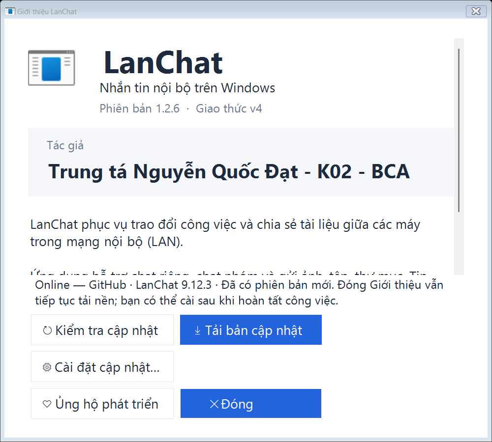
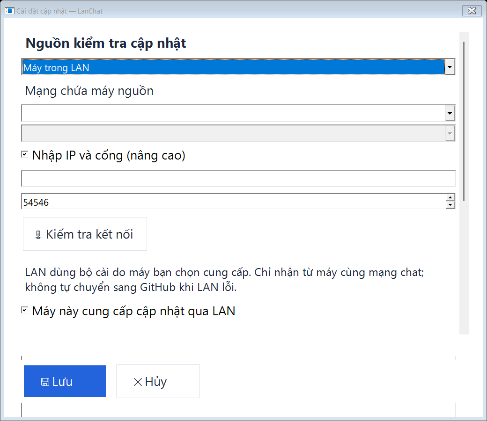
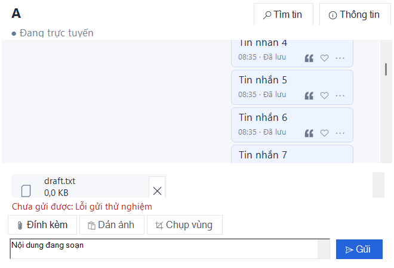

# Kiểm chứng ô soạn, tên tệp và cập nhật LAN

Ngày kiểm tra: 19/11/2026. Giữ giao thức v4, cấu trúc nhận diện đã ký, database và cơ chế truyền đính kèm chat. Không thực thi bộ cài trong kiểm thử.

## Kết quả

- Build Debug và Release: **0 cảnh báo, 0 lỗi**.
- Toàn bộ kiểm thử Release: **170/170 qua**. Sau các chỉnh sửa cuối, chạy lại 18 ca LAN/cấu hình/máy chủ tự cài 13 ca nguồn cập nhật và 4 ca cấu hình: đều qua.
- Hộp thoại SaveFileDialog thật của Windows: `abc.z.exe`, ghi đè `abc.z.exe`, tên tiếng Việt nhiều dấu chấm, `archive.v1.tar.gz` và `README`. Đối chiếu tên trên đĩa, nội dung và đường dẫn trả về từ `PrepareOpenAsync`.
- Bố cục mô phỏng DPI 100%, 150%, 200%: ô soạn, Giới thiệu và Cài đặt cập nhật. Kiểm tra cửa sổ nhỏ, nút Hủy/Lưu/Gửi, lỗi gửi và đính kèm còn truy cập được. Hai tiến trình thực chạy trên màn hình DPI 125%.
- Hai tiến trình mới, dữ liệu riêng: manifest ký bằng khóa thiết bị, truyền bộ cài giả lập qua TCP/TLS, kiểm tra kích thước/SHA-256, đồng thời chat, nhóm, ảnh, tệp và lưu bản chỉnh sửa đều qua. Fixture EXE có metadata đệm khoảng trắng tương tự Inno Setup và không được chạy.
- Hai tiến trình bản mới/v1.2.6: chat riêng/nhóm, tệp, ảnh và thao tác hội thoại qua; bản mới báo rõ máy cũ chưa hỗ trợ cập nhật LAN.
- Bộ cài Inno Setup v1.2.6 đã phát hành: nhận diện sản phẩm/phiên bản và import thành công vào cache thử nghiệm. Dung lượng 5.890.830 byte; SHA-256 `e7164b602700dbc07f2346920ed86c14f3dd4eaa27a5976135a120d3ce98b87c`. Tệp nguồn được giữ nguyên, không chạy EXE.

[Kết quả dạng JSON](verification/lan-update/results.json).

## Các tình huống đã kiểm tra

**Ô soạn:** dòng chủ động, dòng trống cuối, tự quấn, hơn 8 dòng, co lại, khôi phục bản nháp, giữ con trỏ và giữ mốc lịch sử đang đọc. Khi gửi lỗi, giữ nội dung và tệp; tại cửa sổ nhỏ vẫn thấy thông báo lỗi và nút Gửi. Phần xem trước đính kèm được ưu tiên trước phần văn bản mở rộng.

**Cấu hình:** ba nguồn dùng chung; nguồn cục bộ lưu qua khởi động lại; chia sẻ độc lập với nguồn kiểm tra; chặn đổi nguồn khi tải; lỗi lưu không mất dữ liệu nhập. Không dùng tên hiển thị làm khóa. Danh sách máy về muộn không ghi đè mạng mới hoặc xóa dấu thay đổi do người dùng nhập. Cấu hình hỏng không tự chuyển sang GitHub.

**LAN và cache:** không gọi HTTP khi dùng LAN/cục bộ; ghim định danh, kiểm tra chữ ký, từ chối máy sai mạng/định danh, manifest bị sửa, hash sai, cache hỏng và gói đã đổi. Bộ cài đã tải vẫn mở khóa xác minh được khi nguồn offline. Không hạ phiên bản; gói bằng phiên bản máy nguồn vẫn chia sẻ được cho máy khác.

**Phục vụ gói:** tối đa bốn lượt; thay hoặc tắt gói không phá lease đang đọc; hủy/mất kết nối giải phóng lease; từ chối lượt mới theo mạng đã tạm ngừng. Chặn cài trên máy đang phục vụ, ngừng nhận lượt mới trước khi thoát để cài và khôi phục phục vụ sau lỗi xác minh. Không thực thi bộ cài trong ca kiểm tra cài đặt.

**Tệp và metadata:** cache gói bất biến, chỉ công bố sau khi sao chép xong; hủy xóa `.part`; metadata ghi nguyên tử. Lỗi công bố cấu hình giữ nguồn/chia sẻ cũ. Khi cache cũ bị mất vẫn tắt chia sẻ hoặc trở về GitHub được.

## Chạy lại

```powershell
dotnet build LanChat.sln --no-restore
dotnet build LanChat.sln --no-restore -c Release
dotnet test tests/LanChat.Tests/LanChat.Tests.csproj --no-build -c Release
pwsh -NoProfile -File scripts/Verify-TwoInstances.ps1 -WithLanUpdate
```

Để đối chiếu với EXE **Debug** được build từ tag v1.2.6:

```powershell
pwsh -NoProfile -File scripts/Verify-TwoInstances.ps1 `
  -SecondExecutable 'C:\thu-muc-build-v1.2.6\LanChat.WinForms.exe' -ExpectLegacyPeer
```

Script tạo dữ liệu và cổng thử nghiệm riêng, không dùng database đang làm việc. Các lượt kiểm tra tại máy này nằm trong `.codex-temp/test-results`, `.codex-temp/two-instances-lan-update-padded` và `.codex-temp/two-instances-lan-update-v126-final`; dữ liệu thô không được đưa vào bản phát hành.

## Giới hạn kiểm chứng và lỗi nền

- DPI 100/150/200% được mô phỏng bằng kích thước, font và DPI control, không thay cấu hình màn hình Windows. Cần nghiệm thu thêm chuyển màn hình thật và IME tiếng Việt đang gõ trên thiết bị triển khai.
- Hộp thoại lưu chạy với thiết lập Explorer hiện có; không sửa thiết lập Windows để thử riêng cả hai chế độ ẩn/hiện phần mở rộng. Cần đối chiếu thêm chế độ còn lại, đổi tên và Hủy bằng thao tác trực tiếp khi nghiệm thu.
- Hồi quy `OneRemainingHolderAutomaticallySharesAllPagesWithCurrentGroupMembers` từng timeout khi đồng bộ 215 tin trên bản nền trước thay đổi này. Lượt Release hiện tại **đã qua**; không thay thuật toán lịch sử nhóm trong công việc này. Nếu timeout tái diễn, xử lý như lỗi nền riêng.

## Ảnh kiểm chứng

Giới thiệu ở DPI 200%, nút cấu hình nằm trong hàng riêng và không bị cắt:



Cài đặt LAN ở DPI 200%, phần nội dung cuộn và chân cửa sổ giữ nút Lưu/Hủy:



Cửa sổ nhỏ khi gửi lỗi, giữ tệp, nội dung và nút Gửi:


