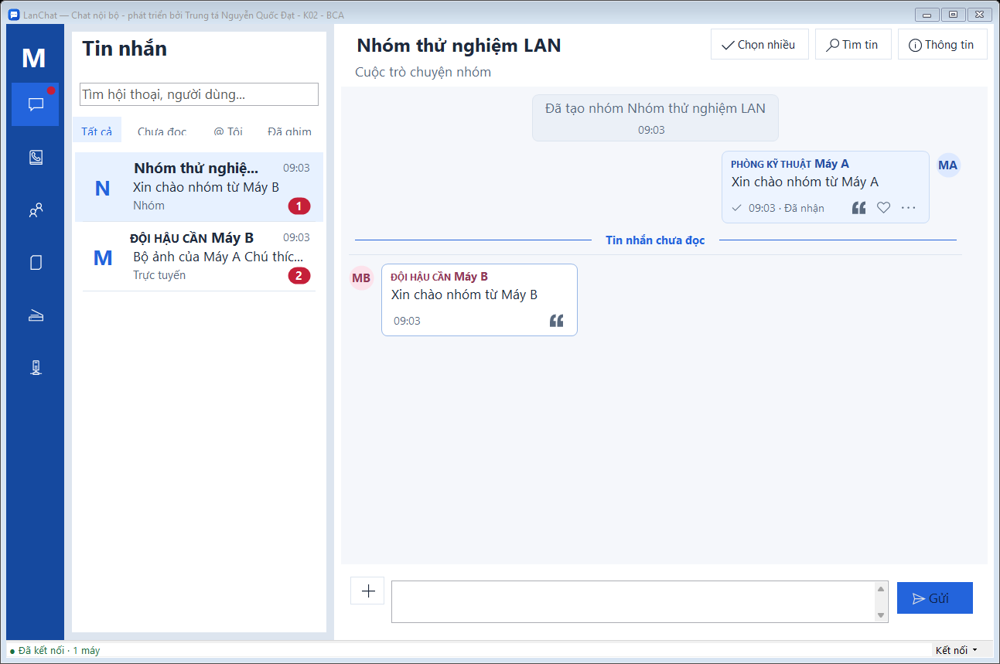

# Kiểm chứng phát hành LanChat v1.2.10

- Đồng bộ Directory.Build.props, CurrentApplicationVersion và phiên bản mặc định của Inno Setup thành 1.2.10.
- Build Debug có ký số: PASS, 0 warning / 0 error. Publish công khai qua LanChatPublicRelease và BuildSignedInstaller.proj: PASS.
- EXE ứng dụng, bộ gỡ và bộ cài ký bằng chứng thư phát triển LanChat 9CC153E400BB35AAD399B6BA9956DC92EF0DC377. Công cụ LanChat.Signing xác minh chữ ký mật mã và tính toàn vẹn PE; Windows vẫn báo untrusted root đối với chứng thư tự ký, không thay trust store.
- Chứng thư thực tế có trong CurrentUser/My và dùng được khi chạy ngoài sandbox. Các lần khảo sát trước báo không tìm thấy là do giới hạn truy cập trong sandbox, không phải thiếu chứng thư trên máy.
- Target đóng gói kiểm tra version ứng dụng và không có resource mã mời nội bộ; payload không có default-network.json, DefaultNetwork.local.json, PFX/P12/KEY.
- Asset cập nhật giữ tên LanChat-Setup-Windows-x64.exe.

## SHA-256

- LanChat.WinForms.exe: ab962e4886a92a48b0152ec4c57d00550453d1198259ae37c4b0d3f38a156c88
- LanChat-Setup-Windows-x64.exe: 4b41e32908130c393f6dd8967fc9714fe696aeb2a9df81b82a6c89431a82e719

Chi tiết máy đọc: [packages.json](verification/v1.2.10/packages.json). Kiểm chứng UI và giới hạn có sẵn: [UI_UX_IMPLEMENTATION.md](UI_UX_IMPLEMENTATION.md).

## Kiểm thử phiên bản

- 221/221 bài tuần tự PASS trên bản Debug đã ký, .NET Framework 4.8. Kết quả gốc ở artifacts/v1.2.10-tests.
- Bài khôi phục lịch sử nhóm lớn đã tái hiện timeout trên HEAD gốc tiếp tục được loại có ghi chú, không tính là PASS.

## Ảnh kiểm thử giao diện

