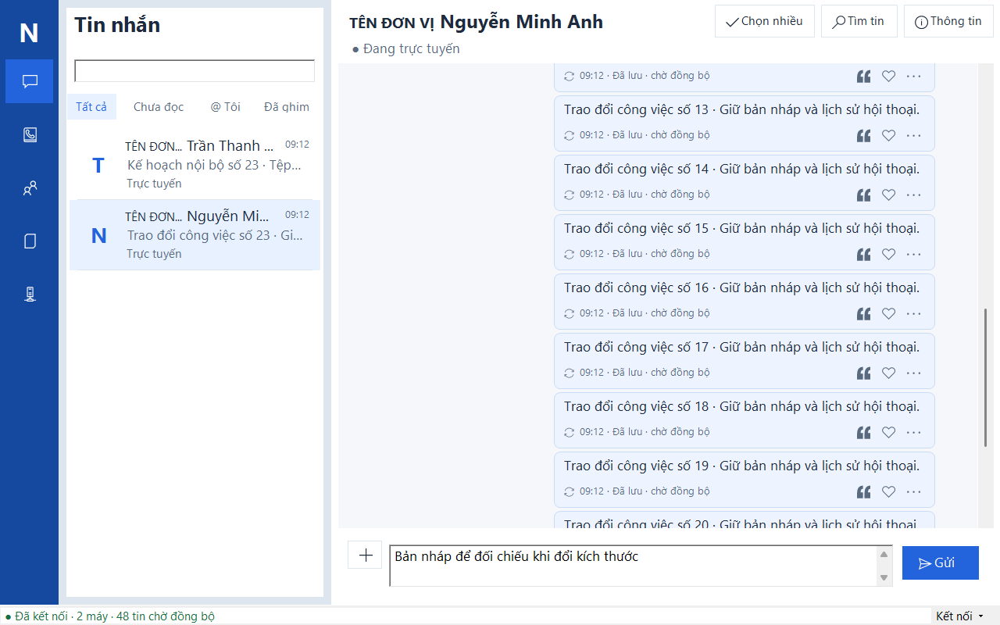

LanChat v1.2.10 — nâng cấp UI/UX

- Bố cục thích ứng cửa sổ rộng, trung bình và hẹp; quay lại danh sách bằng nút mũi tên hoặc Alt+Trái, giữ bản nháp.
- Bộ lọc Tất cả / Chưa đọc / @ Tôi / Đã ghim; điều hướng thu gọn có tooltip và menu Thêm cho giới thiệu/cập nhật/hướng dẫn.
- Trạng thái tin có icon và tooltip, phân biệt đồng bộ với đã nhận/đã đọc theo xác nhận thực.
- Khung soạn gọn với nút +, giữ nhập nhiều dòng, dán ảnh, chụp vùng và kéo thả.
- Trung tâm tệp theo dõi tải nền; đóng cửa sổ không hủy tác vụ, ảnh tiếp tục dùng gallery có sẵn.
- Tìm trong hội thoại hoặc toàn bộ lịch sử với snippet tô từ khóa; tìm thành viên giữ thay đổi chưa lưu.
- QR thêm sao chép nguyên văn, giữ giới hạn 500 byte UTF-8 và xử lý hoàn toàn trên máy.
- Tùy chỉnh cỡ chữ/mật độ, ẩn nội dung thông báo và hướng dẫn bắt đầu; lưu cục bộ, áp dụng ngay.

Giữ WinForms/.NET Framework 4.8, Windows 10/11 x64, giao thức, E2EE/TLS/DPAPI và cấu trúc database. Cài đè bằng cùng tài khoản Windows để giữ dữ liệu và cấu hình. Bộ cài và ứng dụng ký bằng chứng thư phát triển LanChat tự ký; không phải chứng thư CA và Windows/SmartScreen có thể vẫn cảnh báo.

Giới hạn: chưa có dark mode. Kịch bản khôi phục lịch sử nhóm lớn chỉ còn một máy giữ dữ liệu chưa được nghiệm thu đầy đủ; bài kiểm thử này cũng timeout trên mã nguồn gốc. Kiểm chứng DPI gồm ma trận mô phỏng 100–200% và hai tiến trình thật ở DPI 125%; chưa đại diện mọi cấu hình phần cứng.

### Giao diện LanChat v1.2.10

